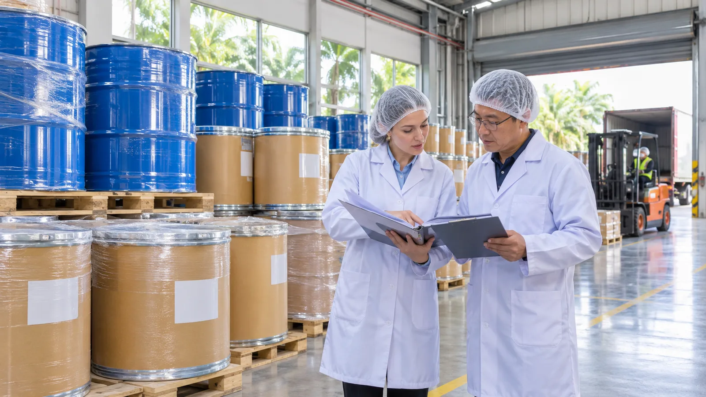

# Phosphatidylserine Import into Singapore: A B2B Buyer's Guide to HSA Market Entry

## Publishing Note

Prepared for Nutranexa B2B buyers, importers, distributors, and brand owners evaluating phosphatidylserine (PS) ingredient imports into Singapore and the wider ASEAN region. Published 4 November 2026. This guide reflects the regulatory steps, documentation, and supplier-readiness checks most relevant to bringing PS raw material into Singapore under the Health Sciences Authority (HSA) health-supplement framework and Singapore Customs procedures.

## Topic Planning Notes

Singapore is Southeast Asia's most mature supplement retail market and the region's leading distribution and reformulation hub, yet published phosphatidylserine sourcing guidance concentrates almost entirely on the US, EU, and China. Buyers searching for "phosphatidylserine import Singapore" or "HSA health supplement ingredient requirements" are typically regional distributors, contract formulators, or brand owners preparing a first consignment through a Singapore entity that will also serve Malaysia, Indonesia, and Vietnam. The search intent is procedural: which obligations, documents, and label decisions stand between a purchased drum of PS powder and a customs-released, retail-ready consignment. This article addresses that intent from the buyer's side of the transaction.

## SEO Keywords

- Primary keyword: phosphatidylserine import Singapore
- Secondary keywords:
  - HSA health supplement requirements Singapore
  - Singapore supplement ingredient import rules
  - Singapore Customs food supplement clearance
  - health supplement labelling Singapore
  - ASEAN supplement distribution hub sourcing
  - phosphatidylserine distributor Singapore

## SEO Metadata

- SEO Title: Phosphatidylserine Import Singapore: HSA Market Entry Guide for B2B Buyers
- Meta Description: A step-by-step B2B guide to importing phosphatidylserine into Singapore — HSA health-supplement obligations, customs documentation, labelling, and supplier-readiness checks.
- URL Slug: /resources/phosphatidylserine-singapore-hsa-market-entry-import/

## Outline

- Why Singapore matters as a market and regional distribution hub
- The HSA health-supplement framework and what it expects from importers
- Importer of record, customs clearance, and the consignment document pack
- Labelling, claims, and allergen positioning for the Singapore market
- Supplier-side readiness: what to confirm before shipping
- FAQ
- Conclusion

## Introduction

For B2B buyers, Singapore punches far above its population size in the supplement economy. It is the region's English-language regulatory benchmark, a preferred base for brand headquarters, and the consolidation point through which many ASEAN distribution programmes are financed, warehoused, and re-exported. The import pathway is governed by the Health Sciences Authority (HSA) for health supplements and by Singapore Customs at the border, and while the regime is lighter-touch than registration-based markets, it places the compliance burden squarely on the local importer and seller. A phosphatidylserine consignment that is fully documented for Rotterdam or New Jersey can still stall if the Singapore importer's obligations, the ingredient dossier, or the label positioning were never aligned with HSA expectations. This guide walks through the market entry sequence from the buyer's perspective: the HSA framework, customs and documentation, labelling and claims, and the supplier-readiness checks that prevent avoidable holds. Most programmes begin with a well-specified [soy-derived phosphatidylserine powder](/products/soy-phosphatidylserine/) whose grade, assay, and document set are already organized for distributor and regulator review.

## Why Singapore Matters as a Market and Regional Hub

Singapore combines high per-capita supplement spending with a regulatory environment designed for trade. There is no pre-market product registration for most health supplements; instead, HSA operates an umbrella framework under which importers, manufacturers, and dealers are responsible for ensuring that products are safe, compliant with applicable guidelines, and honestly labelled. This model rewards disciplined buyers and punishes casual ones: with no gatekeeper reviewing submissions, errors surface at enforcement, at retail complaints, or at the border rather than in an approval file.

The commercial logic is equally distinctive. Because Singapore sits at the centre of ASEAN logistics, buyers frequently use a Singapore entity as the regional master importer, holding PS inventory in bonded or temperature-controlled warehousing and shipping onward to Malaysia, Indonesia, the Philippines, and beyond. That makes the initial Singapore entry a multi-market decision rather than a single-country one. Buyers weighing several Asian destinations in parallel may find it useful to compare approaches in this [phosphatidylserine South Africa SAHPRA market entry guide](/resources/phosphatidylserine-south-africa-sahpra-market-entry-import/), which illustrates the opposite, registration-led model.

## The HSA Health-Supplement Framework and What It Expects from Importers

Under HSA's health-supplement regime, phosphatidylserine destined for finished cognitive-health products is treated as an ingredient in a product category that does not require product-by-product registration. What HSA expects instead is evidence of responsible self-assessment: the importer should hold the ingredient specification, understand the safety rationale and intended use level, and be able to show that the product contains no prohibited or controlled substances and makes no medicinal claims. For a soy-derived PS, the specification should state the source organism, the enzymatic conversion route, and the assay method; for a sunflower-derived PS, the soy-free positioning should be supported consistently across the certificate of analysis, allergen statements, and label artwork.

Practically, buyers should assemble the ingredient dossier before shipping rather than after: the ingredient specification, method summaries for identity and purity testing, heavy-metal and microbiological limits with lot-specific results, allergen and GMO declarations, and the draft finished-product label. Where a Singapore distributor will on-sell into retail chains or pharmacy groups, those buyers routinely audit the ingredient file, so gaps at the raw-material level become delays at the brand level. Working with a supplier whose grades are documented under the controls described on our [quality and R&D page](/quality-rd/) shortens that audit considerably.

<!-- Embedded CTA Box: Sample & Spec Match -->
<aside style="margin:36px 0;padding:24px 28px;background:#f5f8fc;border:1px solid #d7e0ec;border-left:4px solid #102a56;border-radius:3px;font-family:Arial,Helvetica,sans-serif;color:#1a2433;">

Factory Direct · Specification Review

<h3 style="font-family:Arial,Helvetica,sans-serif;font-size:22px;font-weight:700;margin:0 0 10px 0;color:#102a56;">Validating a Phosphatidylserine Grade Before Your First Order?</h3>

Send your current specification, target assay and application. We review grade, source (soy or sunflower), concentration and documentation against your programme, then ship samples with a lot-specific certificate of analysis for validation on your own line.

<a href="/contact/" style="display:inline-block;padding:11px 22px;background:#102a56;color:#fff;font-weight:700;font-size:14px;text-decoration:none;border-radius:2px;">Request Samples &amp; Spec Review →</a>
<a href="/products/phosphatidylserine/" style="display:inline-block;padding:11px 22px;background:#fff;color:#102a56;border:1px solid #102a56;font-weight:700;font-size:14px;text-decoration:none;border-radius:2px;">View Product Specifications</a>

</aside>

## Importer of Record, Customs Clearance, and the Consignment Document Pack

Singapore Customs clearance is among the fastest in the world, but it depends on clean data. The importer of record declares the consignment through the TradeNet system, and there are no import duties on supplements — only prevailing GST to account for at entry. The document pack is familiar in shape to any exporter: commercial invoice, packing list, bill of lading or air waybill, certificate of origin where the buyer's programme requires it, and a lot-specific certificate of analysis. Because clearance speed leaves little time for correction, consistency of product names, manufacturer addresses, and batch numbers across all documents is the single most effective way to avoid queries.

Two PS-specific points deserve attention. First, although duty-free, the declared value must still be supportable, and buyers building regional pricing models should account for freight, insurance, and GST in total cost — the same discipline set out in this [landed cost planning guide for phosphatidylserine imports](/resources/phosphatidylserine-import-duties-landed-cost-us-eu/). Second, storage conditions matter at the destination: PS powder is typically held under controlled temperature and humidity, so confirm that the Singapore warehouse — whether your own, your 3PL's, or your distributor's — can demonstrate those conditions before the first pallet arrives.

## Labelling, Claims, and Allergen Positioning

Labelling obligations for finished supplements sold in Singapore attach at the product level, but the ingredient supplier determines what is achievable. Labels must be in English, follow the applicable food labelling requirements, and declare soy as an allergen where soy-derived PS is used. Health supplements in Singapore must not carry disease-treatment claims; cognitive "support" and "maintenance" style claims must be worded carefully, and any claim made in English source documents must remain supportable in the final artwork. For buyers targeting the region's growing soy-free segment, a [sunflower-derived phosphatidylserine grade](/products/sunflower-phosphatidylserine/) with consistent allergen documentation allows a clean soy-free claim to carry through from raw material to retail label.

Allergen and claim positioning should be reviewed against the ingredient declaration pack before artwork lock, not after printing. Where your programme involves contract packing in Singapore or Malaysia, confirm that the packing site's label review and the translated or market-adapted artwork sit on the critical path alongside production scheduling, since label rework is one of the few delay causes that Singapore's fast customs system cannot absorb.

## Supplier-Side Readiness: What to Confirm Before Shipping

The Singapore pathway rewards buyers who audit supplier readiness before the order rather than during clearance. A short readiness checklist for a Singapore-bound PS programme covers: lot-specific COAs matching the agreed specification; allergen, GMO, and origin statements consistent with the intended label; irradiation-free and residual-solvent statements where applicable; temperature-controlled storage and export packing suitable for tropical transit; and documentation experience with ASEAN destinations. Ask prospective suppliers for a sample document pack from a previous Singapore or Malaysian shipment — manufacturers who can produce one within a day have usually cleared this path before. For first orders, a pilot consignment with a full document rehearsal is cheaper than a regional launch delayed at the warehouse, and it converts regulatory uncertainty into a rehearsed, repeatable process.

<!-- Embedded CTA Box: Compliance & Documentation -->
<aside style="margin:36px 0;padding:26px 28px;background:#102a56;color:#eef2f8;border-radius:3px;font-family:Arial,Helvetica,sans-serif;">

Compliance &amp; Documentation

<h3 style="font-family:Arial,Helvetica,sans-serif;font-size:22px;font-weight:700;margin:0 0 10px 0;color:#fff;">Need COAs, SDS or Market-Specific Compliance Files?</h3>

Every shipment ships with a certificate of analysis and a safety data sheet, and market documentation is prepared per destination — US, EU and APAC programmes each carry their own declaration set. Ask for the document package behind any grade before committing volume.

<a href="/contact/" style="display:inline-block;padding:11px 22px;background:#c69a35;color:#102a56;font-weight:700;font-size:14px;text-decoration:none;border-radius:2px;">Request the Document Package →</a>
<a href="/resources/documents-for-ps-ingredients/" style="display:inline-block;padding:11px 22px;background:transparent;color:#fff;border:1px solid rgba(255,255,255,0.4);font-weight:700;font-size:14px;text-decoration:none;border-radius:2px;">See the Document Checklist</a>

</aside>

## FAQ

### Does phosphatidylserine need HSA registration before import into Singapore?

No. Health supplements, including finished products containing phosphatidylserine, do not require product-by-product registration with HSA. Instead, the importer and seller carry the responsibility to ensure the product is safe, contains no prohibited substances, and complies with HSA's health-supplement guidelines and labelling requirements — which makes the ingredient dossier you obtain from your supplier the core of your compliance file.

### What documents are checked when clearing PS powder through Singapore Customs?

The core pack includes the commercial invoice, packing list, transport document, and where relevant a certificate of origin, declared through TradeNet, together with a lot-specific certificate of analysis available for quality verification. There are no import duties on supplements; prevailing GST applies. Consistency of names, addresses, and batch numbers across documents keeps clearance same-day.

### Is halal certification required for phosphatidylserine in Singapore?

It is not a regulatory requirement, but it can be commercially useful. Singapore's multiracial retail channel includes halal-conscious consumers, and distributors serving Malaysia and Indonesia often prefer ingredients with manufacturer-level halal certification so the same document pack can serve neighbouring markets without requalification.

### What claims can be made for cognitive supplements containing PS in Singapore?

Health supplements must not claim to treat, cure, or prevent disease. Wording should stay within support-and-maintenance territory, and the claim must be substantiated by the ingredient documentation. Review draft claims against your COA, specification, and allergen statements before artwork lock so the label survives distributor and retail review.

## Conclusion

Singapore offers one of the cleanest market entry paths in Asia for phosphatidylserine buyers, provided the absence of product registration is not mistaken for an absence of obligations. The sequence is manageable: confirm your importer of record understands its HSA responsibilities, assemble the ingredient dossier and allergen documentation at the manufacturer level, rehearse the TradeNet document pack, and align English-labelling and claim wording before artwork lock. Buyers who embed these checks into their standard supplier qualification process will find Singapore not only straightforward in its own right but the natural launch pad for the wider ASEAN region. If you are qualifying a manufacturer for Singapore or regional distribution, or need the document package behind a specific grade, our team supports compliance and quality reviews across US, EU, and APAC programmes, and you can [contact us](/contact/) to start a specification match for your Singapore programme.

## Sources

- [Health Sciences Authority — Health Supplements Regulation](https://www.hsa.gov.sg/health-supplements)
- [HSA Guidance on Health Supplements](https://www.hsa.gov.sg/announcements/guidance-on-health-supplements)
- [Singapore Customs — Importing Goods](https://www.customs.gov.sg/businesses/importing-goods/)
- [Singapore Food Agency — Food Labelling Requirements](https://www.sfa.gov.sg/food-import-export/food-labelling-requirements)

## CTA

Planning a phosphatidylserine shipment into Singapore or the wider ASEAN region? Request samples with a lot-specific certificate of analysis, or send your specification for a document-pack review before your first order. Explore our phosphatidylserine grades — soy-derived and sunflower-derived — and let our team match a grade, concentration, and documentation set to your HSA programme.
