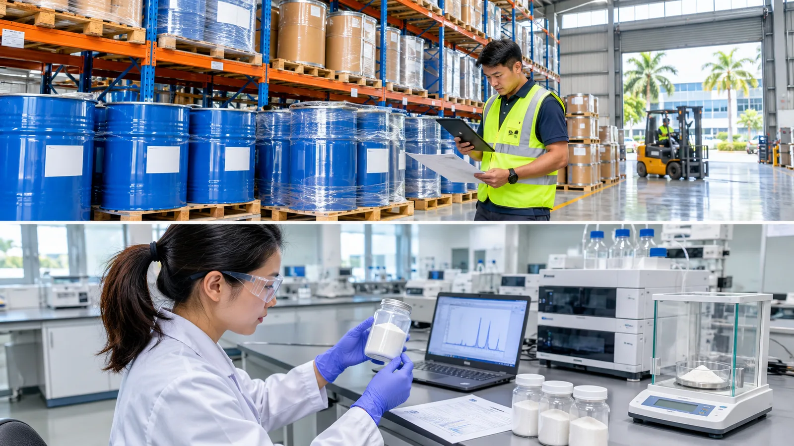

# Phosphatidylserine Import into Malaysia: A B2B Buyer's Guide to NPRA Market Entry

## Publishing Note

Prepared for Nutranexa B2B buyers, importers, distributors, and brand owners evaluating phosphatidylserine (PS) ingredient imports into Malaysia. Published 5 November 2026. This guide reflects the regulatory steps, documentation, and supplier-readiness checks most relevant to bringing PS raw material into Malaysia under the National Pharmaceutical Regulatory Agency (NPRA) health-supplement registration framework, Malaysia Customs procedures, and Malaysian labeling expectations. It is written from the supplier's vantage point and is not legal advice; buyers should confirm current requirements with NPRA or a licensed Malaysian regulatory consultant before filing.

## Topic Planning Notes

Malaysia is the world's most halal-sensitive regulated supplement market and a common second market for distributors who have already entered Singapore or Indonesia, yet published phosphatidylserine sourcing guidance concentrates almost entirely on the US, EU, and China. Buyers searching for "phosphatidylserine import Malaysia" or "NPRA health supplement registration ingredient requirements" are typically regional distributors, Malaysian registration holders, or brand owners preparing a first consignment for Kuala Lumpur or Johor. The search intent is procedural: which registration steps, documents, and halal and labeling decisions stand between a purchased drum of PS powder and a customs-released, shelf-ready product. This article addresses that intent from the buyer's side of the transaction and extends the site's market-entry series to a registration-based ASEAN market.

## SEO Keywords

- Primary keyword: phosphatidylserine import Malaysia
- Secondary keywords:
  - NPRA health supplement registration Malaysia
  - Malaysia supplement ingredient import rules
  - phosphatidylserine Malaysia market entry
  - halal certification phosphatidylserine Malaysia
  - Malaysia health supplement labelling requirements
  - PS bulk supplier Malaysia documentation

## SEO Metadata

- SEO Title: Phosphatidylserine Import Malaysia: NPRA Market Entry Guide for B2B Buyers
- Meta Description: A step-by-step B2B guide to importing phosphatidylserine into Malaysia — NPRA supplement registration, customs documentation, halal and bilingual labelling, and supplier-readiness checks.
- URL Slug: /resources/phosphatidylserine-malaysia-npra-market-entry-import/

## Outline

- Why Malaysia matters as a supplement market and halal benchmark
- The NPRA registration pathway and what it expects from ingredient dossiers
- Importer of record, customs clearance, and the consignment document pack
- Halal certification and bilingual labelling for the Malaysian market
- Supplier-side readiness and buyer implications
- FAQ
- Conclusion

## Introduction

Malaysia combines a large, brand-conscious supplement consumer base with regulatory infrastructure that much of the region treats as the halal gold standard. For phosphatidylserine buyers, however, it is a materially different entry exercise than Singapore: health supplements must be registered with the National Pharmaceutical Regulatory Agency (NPRA) before they can be imported and sold, and the quality of the ingredient dossier a manufacturer provides directly determines how smoothly that registration proceeds. A PS consignment that is fully documented for Rotterdam or New Jersey can still stall if the Malaysian registration holder's dossier, the halal evidence, or the bilingual label data were never aligned upstream. This guide walks through the market entry sequence from the buyer's perspective: the NPRA framework, customs and documentation, halal and labelling requirements, and the supplier-readiness checks that prevent avoidable holds. Most programmes begin with a well-specified [soy-derived phosphatidylserine powder](/products/soy-phosphatidylserine/) whose assay, enzymatic conversion route, and document set are already organized for registration review.

## Main Content

## The NPRA Registration Pathway and What It Expects from Ingredient Dossiers

Malaysia regulates health supplements as registered products under the Control of Drugs and Cosmetics Regulations 1984, administered by NPRA under the Ministry of Health. There is no phosphatidylserine-specific ingredient registration; instead, the finished supplement is registered by a Malaysian-registered company — the registration holder — which submits the product dossier through NPRA's electronic submission system and, once approved, may display the MAL registration number on the product. For the raw-material buyer, the practical consequence is that the ingredient file must be registration-ready before the first purchase order: identity and source documentation (soy or sunflower lecithin and the enzymatic conversion route), assay method references, heavy-metal and microbiological limits with supporting results, and allergen and origin statements that the registration holder can carry into the product dossier without rework.

Registration is evaluation-based, and timelines are longer than notification markets — buyers should budget months, not weeks, and plan first-stock timing around the approval. Because the dossier is built on the supplier's specification, any later change to grade, source, or process becomes a variation obligation for the registration holder, so source and grade stability should be locked at qualification. Buyers comparing registration-based and lighter-touch ASEAN routes in parallel will find the contrast useful in this [Southeast Asia market entry guide](/resources/phosphatidylserine-southeast-asia-market-entry-import-guide/), which maps the regional options side by side.

## Importer of Record, Customs Clearance, and the Consignment Document Pack

As in most registration-based markets, the foreign manufacturer is not the importer of record. The Malaysian registration holder — or an importer acting under its licence — declares the consignment to Malaysia Customs, and the product registration underpins the import declaration. The document pack is familiar in shape: commercial invoice, packing list, bill of lading or air waybill, certificate of origin where the programme requires it, and a lot-specific certificate of analysis that matches the registered specification. Consistency of product names, manufacturer addresses, and batch numbers across the invoice, transport document, and CoA remains the single most effective way to avoid clearance queries, and a shipment whose CoA values drift from the registered specification is a classic detention trigger.

Two PS-specific points deserve attention. First, because clearance depends on a valid product registration, buyers must confirm the registration covers the exact finished product and formulation before committing shipment volume — importing unregistered supplements into Malaysia is an enforcement matter, not a paperwork correction. Second, storage conditions matter at the destination: PS powder is typically held under controlled temperature and humidity, so confirm that the Malaysian warehouse — your distributor's, your 3PL's, or a bonded facility — can demonstrate those conditions before the first pallet arrives.

<!-- Embedded CTA Box: Sample & Spec Match -->
<aside style="margin:36px 0;padding:24px 28px;background:#f5f8fc;border:1px solid #d7e0ec;border-left:4px solid #102a56;border-radius:3px;font-family:Arial,Helvetica,sans-serif;color:#1a2433;">

Factory Direct · Specification Review

<h3 style="font-family:Arial,Helvetica,sans-serif;font-size:22px;font-weight:700;margin:0 0 10px 0;color:#102a56;">Validating a Phosphatidylserine Grade Before Your First Order?</h3>

Send your current specification, target assay and application. We review grade, source (soy or sunflower), concentration and documentation against your programme, then ship samples with a lot-specific certificate of analysis for validation on your own line.

<a href="/contact/" style="display:inline-block;padding:11px 22px;background:#102a56;color:#fff;font-weight:700;font-size:14px;text-decoration:none;border-radius:2px;">Request Samples &amp; Spec Review →</a>
<a href="/products/phosphatidylserine/" style="display:inline-block;padding:11px 22px;background:#fff;color:#102a56;border:1px solid #102a56;font-weight:700;font-size:14px;text-decoration:none;border-radius:2px;">View Product Specifications</a>

</aside>

## Halal Certification and Bilingual Labelling for the Malaysian Market

Malaysia is the market where halal expectations move from "commercially useful" to "commercially decisive." Enzyme-derived phosphatidylserine is typically produced from soy or sunflower lecithin using non-animal enzymes, which gives the ingredient a straightforward halal case — but Malaysian buyers, retailers, and regulators look for halal certification issued or recognized through the JAKIM framework, and foreign certificates should come from certification bodies recognized by JAKIM. A statement letter is not a substitute. Obtain the halal certificate at supplier qualification, confirm it covers the production site and the enzyme system, and keep its scope synchronized with the specification so the registration holder can carry the evidence into their file.

Labelling obligations attach at the finished-product level, but the ingredient supplier determines what is achievable. Finished products sold in Malaysia are generally expected to carry bilingual labelling in Bahasa Malaysia and English, to declare soy as an allergen where soy-derived PS is used, and to stay within health-supplement claim boundaries — disease-treatment claims are not permitted, and cognitive "support" or "maintenance" style wording must remain substantiated by the ingredient documentation. For buyers targeting the region's growing soy-free segment, a [sunflower-derived phosphatidylserine grade](/products/sunflower-phosphatidylserine/) with consistent allergen documentation allows a clean soy-free claim to carry through from raw material to registered label.

## Supplier-Side Readiness and Buyer Implications

The Malaysia pathway rewards buyers who audit supplier readiness before the registration, not during clearance. A short readiness checklist for a Malaysia-bound PS programme covers: lot-specific COAs matching the agreed specification; identity, allergen, GMO, and origin statements consistent with the intended label; a halal certificate from a JAKIM-recognized certification body covering the manufacturing site; temperature-controlled storage and export packing suitable for tropical transit; and change-control commitments, since specification drift after registration creates variation filings. Ask prospective suppliers for a sample document pack from a previous Malaysian or Gulf shipment — manufacturers who can produce one within a day have usually cleared this path before. The same halal discipline applies across the Middle East, as set out in this [halal certificate review checklist](/resources/phosphatidylserine-halal-certificate-review-us-eu/). For first orders, a pilot consignment with a full document rehearsal is cheaper than a launch delayed by a registration gap, and it converts regulatory uncertainty into a rehearsed, repeatable process.

<!-- Embedded CTA Box: Compliance & Documentation -->
<aside style="margin:36px 0;padding:26px 28px;background:#102a56;color:#eef2f8;border-radius:3px;font-family:Arial,Helvetica,sans-serif;">

Compliance &amp; Documentation

<h3 style="font-family:Arial,Helvetica,sans-serif;font-size:22px;font-weight:700;margin:0 0 10px 0;color:#fff;">Need COAs, SDS or Market-Specific Compliance Files?</h3>

Every shipment ships with a certificate of analysis and a safety data sheet, and market documentation is prepared per destination — US, EU and APAC programmes each carry their own declaration set. Ask for the document package behind any grade before committing volume.

<a href="/contact/" style="display:inline-block;padding:11px 22px;background:#c69a35;color:#102a56;font-weight:700;font-size:14px;text-decoration:none;border-radius:2px;">Request the Document Package →</a>
<a href="/resources/documents-for-ps-ingredients/" style="display:inline-block;padding:11px 22px;background:transparent;color:#fff;border:1px solid rgba(255,255,255,0.4);font-weight:700;font-size:14px;text-decoration:none;border-radius:2px;">See the Document Checklist</a>

</aside>

## FAQ

### Does phosphatidylserine itself need NPRA registration before import into Malaysia?

No. NPRA registers the finished health supplement, not the raw ingredient. The Malaysian registration holder submits the product dossier, and the phosphatidylserine ingredient is evaluated through the specification, certificate of analysis, identity documentation, and halal and origin evidence supporting that registration. Confirm the registration scope with your Malaysian partner before shipping, since importing unregistered finished supplements is an enforcement matter.

### Who can register the product and import PS-containing supplements into Malaysia?

The registration holder must be a Malaysian-registered company, typically a local distributor, brand owner, or contract packer acting as the product registrant. The foreign manufacturer supplies the technical dossier and quality documentation, and the registration holder carries the regulatory obligations, so document-delivery terms should be negotiated into the supply agreement before the first order.

### Is halal certification required for phosphatidylserine in Malaysia?

Halal certification of the ingredient is not a technical registration condition in every case, but it is commercially decisive in Malaysia's retail channel and is frequently requested by registration holders and retailers alike. Certification from a JAKIM-recognized body covering the production site is the strongest evidence, and enzyme-derived soy or sunflower PS has a straightforward halal case when the enzyme system is non-animal.

### What labelling rules apply to PS supplements sold in Malaysia?

Finished products are generally expected to carry bilingual labelling in Bahasa Malaysia and English, declare allergens such as soy, and comply with Malaysian labelling and claim requirements for supplements — no disease-treatment claims, and cognitive support wording that the ingredient documentation can substantiate. Review draft claims against the specification and COA before artwork lock so the label survives registration and retail review.

## Conclusion

Malaysia offers phosphatidylserine buyers a regulated, high-value ASEAN market, provided the registration-based model is respected rather than treated as a formality. The sequence is manageable: qualify a specification that is registration-ready, confirm a Malaysian registration holder whose dossier your ingredient file supports, secure halal certification from a JAKIM-recognized body, and align bilingual labelling and claim wording before artwork lock. Buyers who embed these checks into supplier qualification will find Malaysia not only navigable in its own right but a credibility marker for the wider Muslim-majority supplement markets. To review grades and documentation for a Malaysia programme, compare concentrations on our [phosphatidylserine product overview](/products/phosphatidylserine/), or [contact our team](/contact/) for samples, COAs, and a market-specific document package.

## Sources

- [National Pharmaceutical Regulatory Agency (NPRA), Malaysia](https://www.npra.gov.my/) — product registration requirements and guidance for health supplements under the Control of Drugs and Cosmetics Regulations 1984.
- [Ministry of Health Malaysia](https://www.moh.gov.my/) — national health regulatory policy context, including halal pharmaceutical and supplement considerations.
- [Department of Islamic Development Malaysia (JAKIM) — Halal Hub](https://www.halal.gov.my/) — Malaysian halal certification framework and list of recognized foreign halal certification bodies.
- [Food Safety and Quality Division, Ministry of Health Malaysia](http://fsq.moh.gov.my/) — food labelling and nutrition labelling requirements under the Food Act 1983 and Food Regulations 1985.
- [Royal Malaysian Customs Department](https://www.customs.gov.my/) — import declaration and clearance procedures for goods entering Malaysia.

## CTA

Planning a phosphatidylserine shipment into Malaysia or the wider ASEAN region? Request samples with a lot-specific certificate of analysis, or send your specification for a registration-readiness and halal documentation review before your first order. Explore our soy-derived and sunflower-derived phosphatidylserine grades and let our team match a grade, concentration, and documentation set to your NPRA programme.
