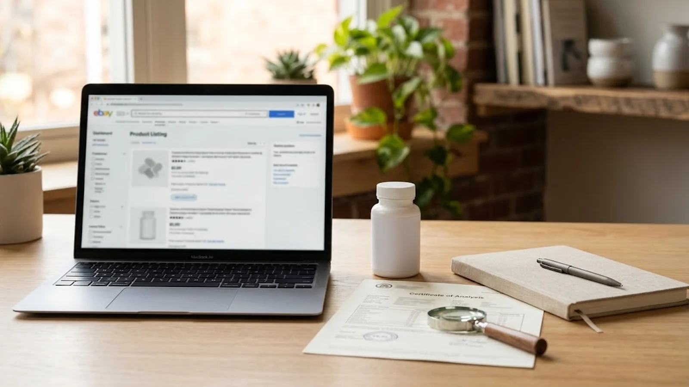
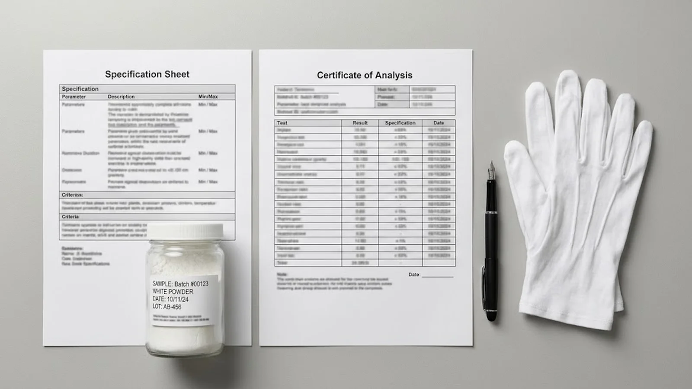

# Phosphatidylserine Amazon Marketplace Compliance: A US and EU Seller Guide

## Publishing Note

- Date: 2026-11-07
- Site and brand: Nutranexa, the international brand of Shandong Nutranexa Biopharmaceutical Co., Ltd.
- Audience: US and European B2B buyers — supplement brand founders and e-commerce managers listing phosphatidylserine products on Amazon, regulatory and QA staff preparing marketplace documentation, and contract manufacturers supporting brand owners' listing requirements.
- Content goal: Explain what Amazon requires from dietary supplement sellers in the US and EU marketplaces, which ingredient documents satisfy those requirements, how claims copy is policed, and how to keep a phosphatidylserine listing compliant lot after lot.
- Scope note: Marketplace policies change without notice and EU member-state food supplement rules vary. Confirm the current Amazon seller policy and destination-country regulations before launch; this guide describes common practice, not legal advice.

## Topic Planning Notes

- Rework reason: This article replaces the queued draft "Phosphatidylserine Freight Damage and Claims" after a collision check found the same slug and topic already published in the repo on 2026-09-21 (`2026-09-21-phosphatidylserine-freight-damage-claims-us-eu.md`). The entire claims/freight direction was excluded, and the suggested gummies-OEM angle was also rejected because the repo already covers gummy formulation (2026-08-13) and gummy format OEM development (2026-09-26).
- Core topic: Amazon marketplace compliance for finished phosphatidylserine supplements — US dietary supplement policy and per-lot COA requirements, EU marketplace rules on notification and distance-selling labeling, claims copy review, and ongoing listing maintenance backed by ingredient documentation.
- Why this topic: The repo covers FDA listing, labeling and EU notification for general channels, but no article addresses the marketplace-specific compliance workflow that e-commerce brand buyers actually face; this fills a quality/compliance gap away from saturated logistics themes.
- Search intent: Compliance problem-solving before and after listing a PS supplement — typically searched by brand owners preparing an Amazon launch or responding to a document request or listing removal.
- ICP focus: DTC and e-commerce supplement brands in the US and EU, regulatory consultants supporting marketplace launches, and contract manufacturers who must supply marketplace-ready documentation.
- Conversion role: Move readers toward specifying supplier documentation early — lot-specific COAs and market declarations — and toward a PS supplier whose document package feeds directly into marketplace submissions.

## SEO Keywords

- Primary Keyword: phosphatidylserine Amazon compliance
- Secondary Keywords: Amazon dietary supplement policy, phosphatidylserine supplement COA requirements, Amazon supplement listing requirements EU, supplement claims Amazon listing, phosphatidylserine product documentation
- Long-tail Keywords:
  - does Amazon require a COA for every lot of a supplement
  - what documents do I need to sell a phosphatidylserine supplement on Amazon
  - how to sell food supplements on Amazon EU marketplaces
  - what claims are restricted in a phosphatidylserine Amazon listing
  - why was my supplement listing removed by Amazon documentation review
- AI Overview / GEO Question Targets:
  - What does Amazon require to list a dietary supplement?
  - Which laboratory qualifications must a supplement COA come from?
  - Are EU food supplement notifications needed to sell on Amazon EU?
  - Who is responsible for marketplace compliance — brand or manufacturer?

## SEO Metadata

- SEO Title: Phosphatidylserine Amazon Compliance: US & EU Seller Requirements
- Meta Description: What Amazon requires from phosphatidylserine supplement sellers in the US and EU — per-lot COAs, ingredient documents, EU notification and distance-selling labels, claims rules, and listing maintenance.
- URL Slug: /resources/phosphatidylserine-amazon-supplement-compliance-us-eu/
- H1: Phosphatidylserine Amazon Marketplace Compliance: A US and EU Seller Guide

## Outline

- H2: Introduction
- H2: What Amazon Requires from Supplement Sellers in the US
- H2: The Ingredient Documents That Feed a Compliant Listing
- H2: EU Marketplaces: Notification, Distance Selling, and Responsible Parties
- H2: Claims Copy: What You Can and Cannot Say in a PS Listing
- H2: Keeping the Listing Compliant Lot After Lot
- H2: FAQ
- H2: Conclusion
- H2: Sources
- H2: CTA

## Introduction

A phosphatidylserine supplement can pass every factory inspection and still be blocked at the marketplace gate. Brand owners discovering this usually do so at the worst moment: the listing is live, ad spend is committed, and Amazon's document request lands with a deadline. The marketplace asks for paperwork that starts further upstream than most sellers expect — with the ingredient.

This guide walks through the compliance chain for PS products on Amazon in the US and EU: the marketplace's supplement policy, the ingredient documents that satisfy it, the EU notification and labeling layer, the claims language that triggers removals, and the lot-level routine that keeps a listing alive. If you are still selecting the raw material, our [bulk phosphatidylserine powder](/products/phosphatidylserine/) page lists the grades and the documentation supplied with each, which is exactly what the marketplace submissions below will draw from.

## Main Content

## What Amazon Requires from Supplement Sellers in the US

Amazon treats dietary supplements as a gated category. The core requirements are stable even as enforcement tightens: the product must be labeled as a dietary supplement under 21 CFR 101.36 with a complete Supplement Facts panel, manufactured in an FDA-registered facility, and supported by a certificate of analysis for the actual product sold. Two details cause most rejections.

First, the COA must match. Amazon increasingly asks for a COA tied to the specific lot or date code of the inventory behind the listing, not a generic marketing document — and it must come from an ISO/IEC 17025-accredited laboratory or the manufacturer's in-house lab with supporting qualification. A finished-product COA that omits identity, potency, and contaminant testing (heavy metals, microbials) is treated as incomplete.

Second, the supplement policy distinguishes the product type. A PS capsule labeled for "memory support" is a conventional supplement; a product positioned with disease language ("treats ADHD," "prevents cognitive decline") leaves the supplement framework entirely and faces removal regardless of paperwork quality.

## The Ingredient Documents That Feed a Compliant Listing

Marketplace compliance is downstream of ingredient compliance. The documents a PS supplier provides map directly onto what Amazon asks the finished-product seller to produce:

| Marketplace requirement | Ingredient document that supports it |
|---|---|
| Product identity and potency on the COA | Lot-specific PS assay (HPLC), fatty acid identity profile |
| Contaminant testing | Heavy metals, microbiological, peroxide value, residual solvents results |
| Allergen and ingredient accuracy | Allergen statement, GMO statement, ingredient specifications |
| Manufacturing in a registered facility | Supplier food facility registration (US FDA) reference |
| Label accuracy | Specification sheet matching the Supplement Facts formulation |

The practical takeaway: ask for the document package before the first production order, and keep it organized per lot. Third-party verification sits mid-chain — for buyers who want the testing layer independently reviewed, the [third-party testing checklist for phosphatidylserine](/resources/phosphatidylserine-third-party-testing-us-eu/) covers how to scope and interpret outside lab work.

One caution: a supplier COA on the raw material is not a finished-product COA. The brand or contract manufacturer still needs testing on the finished capsule, gummy or powder — but a well-documented raw material shortens that work substantially.

<!-- Embedded CTA Box: Sample & Spec Match -->
<aside style="margin:36px 0;padding:24px 28px;background:#f5f8fc;border:1px solid #d7e0ec;border-left:4px solid #102a56;border-radius:3px;font-family:Arial,Helvetica,sans-serif;color:#1a2433;">

Factory Direct · Specification Review

<h3 style="font-family:Arial,Helvetica,sans-serif;font-size:22px;font-weight:700;margin:0 0 10px 0;color:#102a56;">Validating a Phosphatidylserine Grade Before Your First Order?</h3>

Send your current specification, target assay and application. We review grade, source (soy or sunflower), concentration and documentation against your programme, then ship samples with a lot-specific certificate of analysis for validation on your own line.

<a href="/contact/" style="display:inline-block;padding:11px 22px;background:#102a56;color:#fff;font-weight:700;font-size:14px;text-decoration:none;border-radius:2px;">Request Samples &amp; Spec Review →</a>
<a href="/products/phosphatidylserine/" style="display:inline-block;padding:11px 22px;background:#fff;color:#102a56;border:1px solid #102a56;font-weight:700;font-size:14px;text-decoration:none;border-radius:2px;">View Product Specifications</a>

</aside>

## EU Marketplaces: Notification, Distance Selling, and Responsible Parties

Amazon's EU marketplaces add a regulatory layer the US does not have. A food supplement sold in an EU member state must be notified to that state's competent authority under Directive 2002/46/EC — and each member state notification is separate. Selling from amazon.de, amazon.fr and amazon.it means, in practice, three notification regimes with different languages, portals, and label requirements.

Distance selling raises the bar further: under Regulation (EU) No 1169/2011, all mandatory food information must be available to the consumer before purchase — meaning the listing page itself must carry the designation, ingredient list, allergen declaration, net quantity, and nutrition declaration, consistent with the physical label. Amazon EU has also begun requesting evidence of the responsible food business operator established in the EU, which for non-EU brands means an authorised representative arrangement.

The claims layer is stricter too. Regulation (EC) No 1924/2006 applies to the listing page as much as to the carton, and the EU register of permitted claims is far narrower than the US structure-function space. A listing imported unchanged from the US store is a common and expensive mistake.

## Claims Copy: What You Can and Cannot Say in a PS Listing

In the US, structure-function language ("supports memory and focus") is permissible for a supplement with the FDA disclaimer, while disease claims ("treats," "cures," "prevents" a named condition) are prohibited and are the single most common trigger for listing removal. Amazon screens listing titles, bullets, and A+ content with automated and human review; mood, stress, ADHD, dementia, and depression language around PS draws scrutiny quickly.

For EU listings, only authorized health claims from the Article 13 register can appear — and phosphatidylserine has limited authorized claim coverage in the EU, so most compliant PS listings rely on permitted nutrient-function statements or descriptive (non-claim) copy. Translating US copy into German or French word-for-word can convert a permissible US statement into an unauthorized EU claim, so claims need review per market, not just per language.

Both regimes reward the same discipline: keep every benefit statement traceable to a permitted category, keep the disclaimer where required, and keep listing copy consistent with the label and notification file.

## Keeping the Listing Compliant Lot After Lot

Compliance is not a one-time gate. Three routines keep a PS listing stable:

1. **Lot rotation and document retention.** Keep a per-lot file: raw-material COA, finished-product COA, and the statements referenced above. When Amazon requests documents, response speed matters — a missing file during a review window can suspend a listing.
2. **Change control on the formula and supplier.** Switching PS grade, source (soy to sunflower), or contract manufacturer changes the document basis of the listing. Update specs, retest, and revise the label before the new lot ships. The US [dietary supplement product listing requirements](/resources/phosphatidylserine-dietary-supplement-listing-us/) for FDA registration are a related upstream step worth reviewing in the same cycle.
3. **Listing copy audits.** Re-read the live listing each quarter against current policy — including A+ modules and image text, which sellers often forget — and align it with any label change.

Brands that treat marketplace compliance as an extension of supplier quality pass these reviews routinely; brands that treat it as a listing-time paperwork task do not.

<!-- Embedded CTA Box: Compliance & Documentation -->
<aside style="margin:36px 0;padding:26px 28px;background:#102a56;color:#eef2f8;border-radius:3px;font-family:Arial,Helvetica,sans-serif;">

Compliance &amp; Documentation

<h3 style="font-family:Arial,Helvetica,sans-serif;font-size:22px;font-weight:700;margin:0 0 10px 0;color:#fff;">Need COAs, SDS or Market-Specific Compliance Files?</h3>

Every shipment ships with a certificate of analysis and a safety data sheet, and market documentation is prepared per destination — US, EU and APAC programmes each carry their own declaration set. Ask for the document package behind any grade before committing volume.

<a href="/contact/" style="display:inline-block;padding:11px 22px;background:#c69a35;color:#102a56;font-weight:700;font-size:14px;text-decoration:none;border-radius:2px;">Request the Document Package →</a>
<a href="/resources/documents-for-ps-ingredients/" style="display:inline-block;padding:11px 22px;background:transparent;color:#fff;border:1px solid rgba(255,255,255,0.4);font-weight:700;font-size:14px;text-decoration:none;border-radius:2px;">See the Document Checklist</a>

</aside>

## FAQ

### Does Amazon require a COA for every lot of a phosphatidylserine supplement?

Amazon's policy requires a COA supporting the product, and enforcement increasingly expects lot-specific documentation for the inventory behind the listing. In practice, keep a COA per production lot from an ISO/IEC 17025-accredited or qualified in-house laboratory, covering identity, potency, and contaminants. A single marketing COA covering "the product" indefinitely is a common cause of document rejection.

### Can I use the same documents for amazon.com and Amazon EU?

No. The US side rests on FDA facility registration, Supplement Facts compliance, and finished-product COAs. EU marketplaces additionally rely on member-state food supplement notifications, a responsible food business operator established in the EU, and distance-selling labeling under Regulation 1169/2011 with stricter claims rules. The ingredient documents (COAs, specifications, statements) carry over; the compliance structure does not.

### What claims language removes a PS listing fastest?

Disease claims in the US — "treats ADHD," "prevents dementia," "reverses cognitive decline" — and unauthorized health claims in the EU, including translated US structure-function copy. Cognitive-health categories attract automated review, so avoid condition names in titles, bullets, and image text, and keep every benefit statement in the structure-function or permitted-claim space.

### Who is responsible for marketplace compliance — the brand or the manufacturer?

Marketplace accountability sits with the seller of record — the brand. The contract manufacturer and ingredient supplier support with documents (COAs, registrations, specifications, statements), but the brand owns the listing, the claims, and the response to Amazon's requests. This is why brands should audit the supplier document package before the first order, not after the first document request.

## Conclusion

Amazon compliance for a phosphatidylserine supplement is decided upstream of the listing: a well-documented ingredient, a tested finished product, a claims-reviewed copy set, and a per-lot filing routine. Sellers who build this chain launch faster and survive document reviews; sellers who improvise at the document request lose the listing window they paid to create.

If you are selecting a raw-material partner for a marketplace-bound PS product, review the [sunflower-derived phosphatidylserine](/products/sunflower-phosphatidylserine/) and [soy-derived phosphatidylserine](/products/soy-phosphatidylserine/) pages for grade options and the declarations each route carries, and request the full document package with your sample. Compliance paperwork is easiest when it arrives with the powder.

## Sources

- [Amazon Seller Central: Dietary Supplements and Supplement Labels Policy](https://sellercentral.amazon.com/gp/help/external/G20141790)
- [US FDA: Dietary Supplements](https://www.fda.gov/food/dietary-supplements)
- [eCFR: 21 CFR 101.36 — Supplement Facts Labeling](https://www.ecfr.gov/current/title-21/chapter-I/subchapter-B/part-101/subpart-D/section-101.36)
- [Regulation (EU) No 1169/2011 on Food Information to Consumers](https://eur-lex.europa.eu/eli/reg/2011/1169/oj)
- [Regulation (EC) No 1924/2006 on Nutrition and Health Claims](https://eur-lex.europa.eu/eli/reg/2006/1924/oj)

## CTA

Send Nutranexa your phosphatidylserine product route, target marketplace (amazon.com or Amazon EU), and launch timeline. The team can confirm the grades available, the lot-specific COA and market declarations supplied with each, and the document package your listing submission will need — specification sheets, allergen and GMO statements, facility registration references, and per-lot testing support for your contract manufacturer.

Suggested CTA button: `Request PS Marketplace Document Package`
