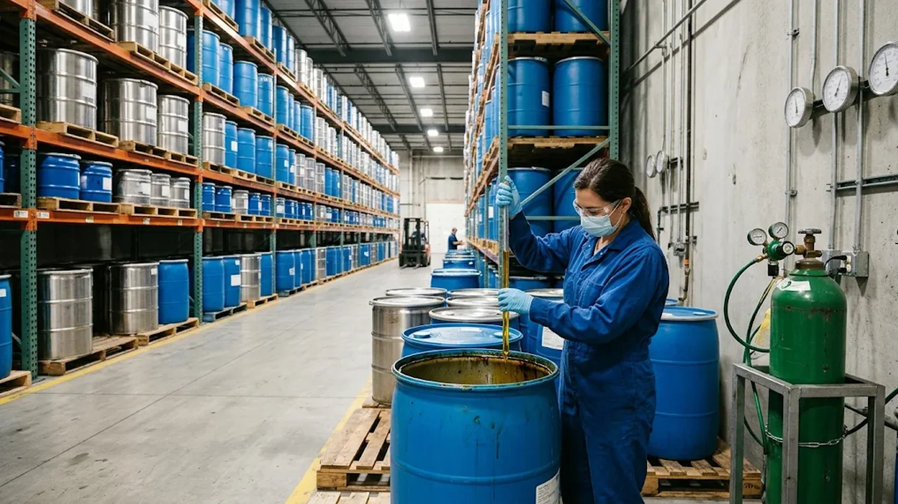

# Phosphatidylserine Antioxidant Systems: Tocopherol Specs Buyers Should Audit

## Publishing Note

- Site: nutranexaps (Nutranexa — B2B phosphatidylserine ingredient supplier)
- Target audience: procurement managers, QA/RD buyers, and contract manufacturers sourcing PS powder for supplements and functional foods in the US and EU
- Publish date: 2026-11-08
- Author: Nutranexa technical sourcing desk
- Internal assets referenced: two webp images (generated separately)

## Topic Planning Notes

- Rationale: the existing content library covers oxidative stability testing and peroxide value limits in depth, but no article addresses the antioxidant system inside the ingredient itself — what is added (tocopherols, ascorbyl palmitate), how it is declared in the specification and on the COA, how its source (soy vs sunflower-derived) interacts with non-GMO and allergen positioning, and how it affects price and documentation.
- Dedup check: grepped `antioxidant`, `tocopherol`, `palmitate`, `vitamin-e` against all 221 existing slugs — zero matches. Nearest neighbours (peroxide value review, oxidative stability testing, non-GMO allergen verification) cover testing and claim verification, not the antioxidant package in the spec. Angle is distinct.
- Buyer intent: specification review before first order, COA audit on arrival, and supplier negotiation leverage.

## SEO Keywords

- phosphatidylserine antioxidant
- phosphatidylserine tocopherol specification
- mixed tocopherols phospholipid powder
- phosphatidylserine COA antioxidant content
- sunflower-derived tocopherols phosphatidylserine
- phosphatidylserine spec review us eu

## SEO Metadata

- SEO Title: Phosphatidylserine Antioxidant Systems: Tocopherol Specs to Audit
- Meta Description: Review the antioxidant system in phosphatidylserine specs before you buy — tocopherol type and source, COA declarations, allergen and label impacts, and cost drivers for US and EU programmes.
- URL Slug: /resources/phosphatidylserine-antioxidant-system-tocopherol-spec-us-eu/
- H1: Phosphatidylserine Antioxidant Systems: Tocopherol Specs Buyers Should Audit

## Outline

1. Why PS needs an antioxidant system (chemistry of phospholipid oxidation)
2. Reading the antioxidant lines in the specification and COA
3. Declaration, allergen and labelling implications in the US and EU
4. Commercial impact: grade, source and price negotiation
5. FAQ, conclusion, sources

## Introduction

When buyers compare phosphatidylserine (PS) quotations, they usually focus on assay percentage, price and lead time. The antioxidant system inside the powder rarely gets the same attention — yet it quietly shapes shelf life, label declarations, allergen positioning and landed cost. Many commercial PS powders carry a small addition of mixed tocopherols or ascorbyl palmitate to protect the phospholipids during drying, storage and shipping; its identity, source and declared amount belong in your supplier review, not the fine print. This article explains what a well-built PS specification says about its antioxidant package, which documents should back it up, and where it changes the commercial conversation with a supplier. If you are building a specification from scratch, [start from the product specifications for our phosphatidylserine grades](/products/phosphatidylserine/), then apply the checks below line by line.

## Main Content

### Why Phosphatidylserine Needs an Antioxidant System

Phosphatidylserine is a phospholipid whose fatty acid chains — typically linoleic, oleic and, in soy-derived grades, linolenic acid — are unsaturated and therefore vulnerable to oxidation. When those double bonds react with oxygen, peroxides and secondary oxidation products form, showing up analytically as a rising peroxide value and organoleptically as off-notes and colour shift. Oxidation does not just degrade sensory quality; it can lower measured PS content over time and shorten the retest period a supplier is willing to state.

Manufacturers therefore control oxidation at three levels: process (gentle, low-oxygen drying), packaging (nitrogen-flushed, high-barrier containers) and formulation — a small addition of antioxidant built into the raw material. The most common systems are mixed tocopherols (natural vitamin E, a concentrate of alpha-, beta-, gamma- and delta-tocopherols) and ascorbyl palmitate, sometimes combined: tocopherols interrupt the radical chain reaction inside the lipid phase, while ascorbyl palmitate regenerates oxidised tocopherol at the lipid interface. Rosemary extract appears in some food applications but is rare in supplement-grade PS because of flavour carry-through.

The practical point: two powders with an identical 50% or 70% PS assay are not equivalent if one declares added tocopherols and the other does not — stability behaviour, ingredient declarations and, often, prices will differ. Treat the antioxidant system as a named specification item, not an incidental.

### Reading the Antioxidant Lines in the Specification and COA

A complete PS specification should declare the antioxidant system explicitly. When reviewing a supplier spec or auditing a COA, check:

- **Identity and form.** "Mixed tocopherols" is not a complete identity. Ask which form: d-alpha (natural) vs dl-alpha (synthetic) tocopherol, and whether the concentrate is standardized on total tocopherol content. Ascorbyl palmitate should likewise be named, including its own assay.
- **Amount.** The specification should state a range, not just "with added tocopherols". A declared range lets you verify each lot on the COA and lets your R&D account for it in mass balance.
- **Source.** Tocopherol concentrates are derived from soybean, sunflower or rapeseed oil. For a sunflower-PS or soy-free positioning, the antioxidant source matters as much as the phospholipid source — a sunflower-derived PS stabilised with soy-derived tocopherols complicates a "soy-free" claim. Verify the source in writing, in the allergen and GMO statements.
- **Grade.** The concentrate should be food-grade compliant in the destination market and carry its own documentation trail.
- **COA reporting.** Confirm the COA includes a measured line for antioxidant content — not just the PS assay, peroxide value and moisture. If the supplier only guarantees the antioxidant "by formulation" (added but never tested), factor that into risk scoring. A vague antioxidant line is exactly the kind of detail that [a structured red-flag audit of supplier COAs](/resources/phosphatidylserine-coa-red-flags-audit-us-eu/) is designed to catch.

One more check: the antioxidant should appear in the composition table with a consistent name across the specification, SDS and allergen statement. Inconsistency is a small finding at qualification but a customs or label dispute later.

<!-- Embedded CTA Box: Sample & Spec Match -->
<aside style="margin:36px 0;padding:24px 28px;background:#f5f8fc;border:1px solid #d7e0ec;border-left:4px solid #102a56;border-radius:3px;font-family:Arial,Helvetica,sans-serif;color:#1a2433;">

Factory Direct · Specification Review

<h3 style="font-family:Arial,Helvetica,sans-serif;font-size:22px;font-weight:700;margin:0 0 10px 0;color:#102a56;">Validating a Phosphatidylserine Grade Before Your First Order?</h3>

Send your current specification, target assay and application. We review grade, source (soy or sunflower), concentration and documentation against your programme, then ship samples with a lot-specific certificate of analysis for validation on your own line.

<a href="/contact/" style="display:inline-block;padding:11px 22px;background:#102a56;color:#fff;font-weight:700;font-size:14px;text-decoration:none;border-radius:2px;">Request Samples &amp; Spec Review →</a>
<a href="/products/phosphatidylserine/" style="display:inline-block;padding:11px 22px;background:#fff;color:#102a56;border:1px solid #102a56;font-weight:700;font-size:14px;text-decoration:none;border-radius:2px;">View Product Specifications</a>

</aside>

### Declaration, Allergen and Labelling Implications in the US and EU

In the **United States**, tocopherols added for stability are typically declared on the finished-product label as "mixed tocopherols (preservative)" or as vitamin E. If the concentrate is soy-derived, the allergen question needs a documented answer: while highly refined soybean oil is exempt from FALCPA's major-allergen declaration, tocopherol concentrates are not refined oils, so require written confirmation of the soy-derived status. The FDA's FALCPA guidance is your regulatory team's reference frame. If your brand carries a non-GMO or soy-free claim, the antioxidant source statement becomes part of the claim substantiation file — [our article on non-GMO and allergen verification for PS](/resources/phosphatidylserine-non-gmo-allergen-verification-us-eu/) covers how to assemble that file.

In the **European Union**, tocopherols are regulated food additives under Regulation (EC) No 1333/2008 (E 306–E 309 for natural and synthetic tocopherol extracts; E 304 for ascorbyl palmitate) and may be used only within permitted conditions. For ingredients sold for further processing into supplements, expect the antioxidant in the composition documentation and in the finished product's ingredient list per EU food information rules. Carriers and solvents in the tocopherol concentrate should also be identified, because they affect both additive compliance and the finished-product declaration.

The consequence: the antioxidant system can change what your label says, so review it at sample stage — and the antioxidant's supply chain enters your documentation scope despite its minor weight.

### Commercial Impact: Grade, Source and Price Negotiation

Understanding the antioxidant system also improves your negotiation position:

- **Natural vs synthetic.** Natural mixed tocopherol concentrates (d-forms, derived from vegetable oil distillate) are materially more expensive than synthetic dl-alpha-tocopherol. A quote that seems high may simply reflect a natural, higher-alpha concentrate; a low quote may hide a minimal synthetic addition with weaker stability support.
- **Source matching.** Sunflower-derived tocopherols in a sunflower-PS grade support allergen-clean positioning but narrow the supply pool and usually add cost. Decide early whether the claim benefit justifies the cost.
- **Documented value.** Ask each supplier for the stability evidence behind their antioxidant level and how content is verified per lot. A slightly higher price backed by per-lot antioxidant testing is often cheaper once you count rejected lots and lab disputes.
- **Specification leverage.** If a supplier's standard grade carries an antioxidant level that does not suit your programme, customisation is usually possible at commercial volumes — but lock it into the specification, the COA test panel and change-control notifications so it cannot be silently adjusted later.

### A Buyer's Checklist for the Antioxidant System

Before committing a PS grade to a programme, run this five-point check:

1. Named identity and declared range in the specification (tocopherol form, ascorbyl palmitate, amount).
2. Written source statement — soy, sunflower or rapeseed origin — matched against your allergen and non-GMO claims.
3. Antioxidant content reported per lot on the COA, with the test method identified.
4. Consistency across specification, SDS and allergen statement.
5. Stability evidence supporting the declared retest period at the stated storage conditions.

Suppliers who can answer all five without hesitation are telling you something about their documentation culture — the same culture you will rely on during audits, complaints and change notifications.

<!-- Embedded CTA Box: Compliance & Documentation -->
<aside style="margin:36px 0;padding:26px 28px;background:#102a56;color:#eef2f8;border-radius:3px;font-family:Arial,Helvetica,sans-serif;">

Compliance &amp; Documentation

<h3 style="font-family:Arial,Helvetica,sans-serif;font-size:22px;font-weight:700;margin:0 0 10px 0;color:#fff;">Need COAs, SDS or Market-Specific Compliance Files?</h3>

Every shipment ships with a certificate of analysis and a safety data sheet, and market documentation is prepared per destination — US, EU and APAC programmes each carry their own declaration set. Ask for the document package behind any grade before committing volume.

<a href="/contact/" style="display:inline-block;padding:11px 22px;background:#c69a35;color:#102a56;font-weight:700;font-size:14px;text-decoration:none;border-radius:2px;">Request the Document Package →</a>
<a href="/resources/documents-for-ps-ingredients/" style="display:inline-block;padding:11px 22px;background:transparent;color:#fff;border:1px solid rgba(255,255,255,0.4);font-weight:700;font-size:14px;text-decoration:none;border-radius:2px;">See the Document Checklist</a>

</aside>

## FAQ

### Q: Does every phosphatidylserine powder contain added antioxidants?

A: No. Addition depends on the manufacturer, concentration and carrier system. Some rely on process and packaging controls with minimal or no antioxidant addition; others declare a defined tocopherol or ascorbyl palmitate level. Never assume — read the composition table and confirm in writing.

### Q: Can I request a phosphatidylserine grade without tocopherols?

A: Usually yes at commercial volumes — many manufacturers can adjust the formulation. The trade-offs are reduced oxidative protection, a likely shorter retest period and more demanding storage on your side. Ask the supplier to quantify the difference with their stability data before deciding.

### Q: Do soy-derived tocopherols trigger soy allergen labelling on my finished product?

A: It depends on jurisdiction and how the concentrate is processed. Tocopherol concentrates are not highly refined oils, so the exemption that applies to refined soybean oil should not be assumed for them. Require a written allergen statement from the supplier covering the antioxidant system, and have your regulatory team confirm the finished-goods declaration for each market.

### Q: What documents should I ask for about the antioxidant system specifically?

A: The specification page with identity and declared range, the COA line showing measured antioxidant content and test method, the allergen statement covering the tocopherol source, the GMO statement if you carry such claims, and the stability summary supporting the stated retest period.

## Conclusion

The antioxidant system is a small part of a phosphatidylserine specification by weight but a large part of it by consequence. It shapes oxidative stability, label declarations, allergen positioning and price — and one of the easiest things to check before the first order. Put the antioxidant's identity, amount, source and per-lot verification into your supplier review, and keep those lines consistent across every supplier document. To benchmark a current grade against a well-documented alternative, [send us your specification](/contact/) — our quality and R&D team reviews antioxidant, carrier and packaging lines together and responds with samples and a lot-specific document package. For buyers whose allergen or label-positioning requirements point to a non-soy source, our [sunflower-derived phosphatidylserine](/products/sunflower-phosphatidylserine/) is produced under the same tocopherol-free antioxidant review.

## Sources

1. [eCFR — 21 CFR Part 182: Substances GRAS in Food (incl. tocopherols)](https://www.ecfr.gov/current/title-21/chapter-I/subchapter-B/part-182)
2. [EUR-Lex — Regulation (EC) No 1333/2008 on Food Additives](https://eur-lex.europa.eu/legal-content/EN/TXT/?uri=CELEX%3A32008R1333)
3. [FDA — Food Allergen Labeling and Consumer Protection Act (FALCPA)](https://www.fda.gov/food/food-labeling-nutrition/food-allergen-labeling-and-consumer-protection-act-2004-falcpa)
4. [PubChem — Alpha-Tocopherol (compound profile)](https://pubchem.ncbi.nlm.nih.gov/compound/14985)

## CTA

Nutranexa supplies soy-derived and sunflower-derived phosphatidylserine with complete, lot-specific documentation — specification, COA, SDS and market files. Contact us for samples, spec review or a document package for your next programme.
