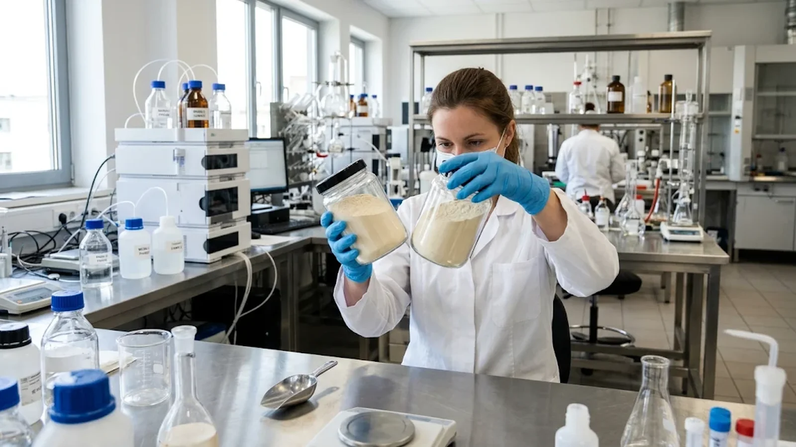

# Phosphatidylserine vs Phosphatidylcholine: Choosing the Right Phospholipid Ingredient

## Publishing Note

- Site: nutranexaps (Nutranexa — B2B phosphatidylserine ingredient supplier)
- Target audience: procurement managers, QA/RD buyers, and contract manufacturers comparing phospholipid ingredients for supplements and functional foods in the US and EU
- Publish date: 2026-11-09
- Author: Nutranexa technical sourcing desk
- Internal assets referenced: two webp images (generated separately)

## Topic Planning Notes

- Rationale: the existing library covers soy vs sunflower sourcing, concentration grades, identity testing and formulation formats in depth, but no article compares PS against the other phospholipids buyers routinely quote — phosphatidylcholine, phosphatidylethanolamine and commodity lecithin — from a specification and commercial-selection angle.
- Dedup check: grepped `phosphatidylcholine`, `phospholipid`, `lecithin`, `feedstock`, `classification` across all 220+ existing slugs. Phosphatidylcholine appears only inside manufacturing, identity-testing and cost-driver articles; lecithin appears as the upstream raw material; no article makes the head-to-head comparison. Nearest neighbours (soy vs sunflower sourcing guide, concentration grades compared) compare PS variants against each other, not PS vs other phospholipids. No overlap with unpublished queue slugs (Amazon compliance, antioxidant/tocopherol, Indonesia BPOM, Japan FSS, Korea MFDS). Angle is distinct.
- Buyer intent: ingredient shortlisting for cognitive and functional formulations, specification review before first order, and supplier negotiation leverage.

## SEO Keywords

- phosphatidylserine vs phosphatidylcholine
- phospholipid selection supplement formulation
- phosphatidylcholine specification bulk ingredient
- phosphatidylserine phospholipid profile COA
- lecithin vs phospholipid concentrate
- cognitive ingredient sourcing us eu

## SEO Metadata

- SEO Title: Phosphatidylserine vs Phosphatidylcholine: Buyer's Selection Guide
- Meta Description: Compare phosphatidylserine and phosphatidylcholine before you buy — chemistry, claims, phospholipid profiles in specs and COAs, sourcing trade-offs and a selection checklist for US and EU formulation programmes.
- URL Slug: /resources/phosphatidylserine-vs-phosphatidylcholine-phospholipid-selection-us-eu/
- H1: Phosphatidylserine vs Phosphatidylcholine: Choosing the Right Phospholipid Ingredient

## Outline

1. Why the phospholipid choice matters for formulation buyers
2. What separates phosphatidylserine from phosphatidylcholine
3. Reading phospholipid profiles in specifications and COAs
4. Sourcing, positioning and cost trade-offs
5. A selection checklist for PS and PC programmes
6. FAQ, conclusion, sources

## Introduction

Few ingredient decisions confuse first-time formulation buyers as reliably as the phospholipid family. Quotations arrive for phosphatidylserine powder, phosphatidylcholine concentrates, "high-PC lecithin" and mixed phospholipid complexes, often at prices that differ by an order of magnitude, behind claims that sound interchangeable. They are not. Phosphatidylserine (PS) and phosphatidylcholine (PC) are distinct molecules with different headgroups, different physiological stories, different regulatory treatment and very different price structures — and choosing between them, or deciding how they work together in one formula, shapes your specification, your label and your cost per serving. This article compares the two from a B2B sourcing angle: what each one is, how each appears on a specification and certificate of analysis, what the documentation trail looks like, and where each makes commercial sense. If your programme has already settled on PS, [review our phosphatidylserine grade specifications](/products/phosphatidylserine/) as the reference point for the comparison below.

## Main Content

### Why the Phospholipid Choice Matters for Formulation Buyers

Phospholipids are the structural molecules of cell membranes: a glycerol backbone carrying two fatty acid chains and a phosphate headgroup that defines the molecule's name and behaviour. Lecithin — the raw material most phospholipid ingredients are refined from — is itself a mixture, typically containing phosphatidylcholine, phosphatidylethanolamine (PE), phosphatidylinositol (PI) and smaller amounts of other fractions. Bulk food-grade lecithin usually carries a combined phospholipid content in the 60–65% range, and its commercial value lies in emulsification rather than in any specific nutritional story.

That matters commercially because buyers often price-check a PS quotation against lecithin or a PC concentrate without registering that they are comparing different ingredient categories. A cognitive supplement with a structure-function dossier needs PS as the named active. An emulsion, a liposomal carrier or a choline-positioned product may need PC. A price-driven functional food may be satisfied with standard lecithin. Matching the molecule to the claim is the first sourcing decision; everything else — assay, grade, documentation and price — follows from it.

### What Separates Phosphatidylserine from Phosphatidylcholine

Chemically, the difference sits in the headgroup. Phosphatidylserine carries L-serine attached to the phosphate; phosphatidylcholine carries choline. Everything downstream flows from that difference.

Phosphatidylserine is the signature cognitive phospholipid. In the United States it is sold as a dietary supplement active carrying structure-function claims; in the European Union it has passed through novel food evaluation, which shapes which suppliers and documentation sets importers can rely on. Because natural PS is scarce, commercial PS is produced enzymatically: phospholipase D converts the choline headgroup of PC-rich lecithin fractions into serine, which is why PS production capacity and price track the lecithin feedstock market. Bulk PS powders are usually offered at 50% or 70% assay, with the balance made up of companion phospholipids and carriers.

Phosphatidylcholine is the most abundant phospholipid in lecithin and is positioned around its choline contribution and emulsifying function. PC concentrates run from roughly 35% to more than 90% assay depending on fractionation depth, and prices sit well below PS at every tier. PC is also the direct raw material for PS manufacturing, which is why suppliers of one family can often quote the other.

Phosphatidylethanolamine and phosphatidylinositol complete the picture: PE contributes emulsifying performance in beverage and bakery systems, and PI supports oil-in-water stabilisation. None of them substitutes for PS in a cognitive claim, and none carries the same documentation expectations — a point worth remembering when a supplier offers a "phospholipid complex" that looks like PS at half the price.

<!-- Embedded CTA Box: Sample & Spec Match -->
<aside style="margin:36px 0;padding:24px 28px;background:#f5f8fc;border:1px solid #d7e0ec;border-left:4px solid #102a56;border-radius:3px;font-family:Arial,Helvetica,sans-serif;color:#1a2433;">

Factory Direct · Specification Review

<h3 style="font-family:Arial,Helvetica,sans-serif;font-size:22px;font-weight:700;margin:0 0 10px 0;color:#102a56;">Validating a Phosphatidylserine Grade Before Your First Order?</h3>

Send your current specification, target assay and application. We review grade, source (soy or sunflower), concentration and documentation against your programme, then ship samples with a lot-specific certificate of analysis for validation on your own line.

<a href="/contact/" style="display:inline-block;padding:11px 22px;background:#102a56;color:#fff;font-weight:700;font-size:14px;text-decoration:none;border-radius:2px;">Request Samples &amp; Spec Review →</a>
<a href="/products/phosphatidylserine/" style="display:inline-block;padding:11px 22px;background:#fff;color:#102a56;border:1px solid #102a56;font-weight:700;font-size:14px;text-decoration:none;border-radius:2px;">View Product Specifications</a>

</aside>

### Reading Phospholipid Profiles in Specifications and COAs

The single most useful document in this comparison is the phospholipid profile. A well-built specification for either ingredient declares the individual fractions — PS, PC, PE, PI and phosphatidic acid — with measured values reported on the COA, not just a combined "total phospholipids" line.

For PS powders, check three things. First, the assay method: HPLC against reference standards is the defensible method, and the COA should name it. Second, the companion fractions: a 50% PS grade will typically declare PC, PE, PI and PA at low percentages, and those numbers should be consistent lot to lot — drift in the companion profile usually signals a raw-material change. Third, consistency across documents: the composition table should agree between specification, SDS and allergen statement. When the profile is missing or reduced to a single number, you lose the ability to verify that you are buying PS rather than an unlabelled phospholipid mixture.

For PC concentrates, apply the same logic in reverse: the PC assay plus the combined level of the other fractions defines the grade, and identity work — fatty acid profile alongside phospholipid distribution — is what distinguishes a genuine PC concentrate from liquid lecithin sold at a premium. [Our review of identity testing and fatty acid profiling for phosphatidylserine](/resources/phosphatidylserine-identity-testing-fatty-acid-profile-us-eu/) walks through the analytical set in detail, and the same framework applies to PC grades.

### Sourcing, Positioning and Cost Trade-offs

Commercially, the two families behave differently. PS prices are driven by the enzymatic conversion step and by lecithin feedstock availability, so soy-derived and sunflower-derived PS track different agricultural markets, supply concentration is higher and lead times run longer. PC concentrates are produced at much larger scale and cost substantially less per kilo at comparable assay tiers.

Positioning rules differ too. A soy-derived PS supports the classic cognitive positioning but raises allergen and non-GMO questions; a sunflower-derived PS addresses soy-free programmes at a premium. For PC, positioning usually turns on the choline story and on whether the emulsifier role can be filled by standard lecithin instead.

The hybrid decision deserves attention: many cognitive formulas combine PS and PC, with PC contributing bulk phospholipid content at low cost while PS carries the active claim. When that is the plan, buying both from related supply chains simplifies documentation and change control — but keep the two specifications separate, because the fractions, assay methods and claim substantiation are not interchangeable. For grade decisions on the PS side, [our comparison of phosphatidylserine concentration grades](/resources/phosphatidylserine-concentration-grades-compared-us-eu/) sets out where 50% and 70% assays make sense.

### A Selection Checklist for PS and PC Programmes

Before shortlisting either ingredient, run five checks:

1. Match the molecule to the claim — PS for the cognitive active, PC for choline or emulsification positioning, lecithin where emulsification alone suffices.
2. Require the individual phospholipid profile on the COA, not a single total-phospholipids number.
3. Confirm the source — soy or sunflower — in writing across allergen, GMO and origin statements.
4. Compare prices at equivalent assay tiers and equivalent documentation depth, never between categories.
5. Ask each supplier for stability data and retest periods at your storage conditions.

A supplier who can produce those documents without hesitation will handle audits, complaints and change notifications the same way.

<!-- Embedded CTA Box: Compliance & Documentation -->
<aside style="margin:36px 0;padding:26px 28px;background:#102a56;color:#eef2f8;border-radius:3px;font-family:Arial,Helvetica,sans-serif;">

Compliance &amp; Documentation

<h3 style="font-family:Arial,Helvetica,sans-serif;font-size:22px;font-weight:700;margin:0 0 10px 0;color:#fff;">Need COAs, SDS or Market-Specific Compliance Files?</h3>

Every shipment ships with a certificate of analysis and a safety data sheet, and market documentation is prepared per destination — US, EU and APAC programmes each carry their own declaration set. Ask for the document package behind any grade before committing volume.

<a href="/contact/" style="display:inline-block;padding:11px 22px;background:#c69a35;color:#102a56;font-weight:700;font-size:14px;text-decoration:none;border-radius:2px;">Request the Document Package →</a>
<a href="/resources/documents-for-ps-ingredients/" style="display:inline-block;padding:11px 22px;background:transparent;color:#fff;border:1px solid rgba(255,255,255,0.4);font-weight:700;font-size:14px;text-decoration:none;border-radius:2px;">See the Document Checklist</a>

</aside>

## FAQ

### Q: Is phosphatidylserine a type of phosphatidylcholine?

A: No. They are different phospholipids with different headgroups — serine for PS, choline for PC. A phospholipid profile on the COA separates them clearly, which is why buyers should require individual fraction values rather than a combined phospholipid figure.

### Q: Can I use lecithin instead of phosphatidylserine in a cognitive formulation?

A: Standard lecithin contains little or no PS, so it cannot carry a phosphatidylserine claim. Lecithin is an emulsifier and a choline source; if the finished product makes cognitive structure-function claims on PS, the formula needs a declared PS assay from a qualified ingredient.

### Q: Why is phosphatidylserine so much more expensive than phosphatidylcholine?

A: PS is made by enzymatically converting PC-rich lecithin fractions with phospholipase D and L-serine, an additional processing step with yield losses, on top of fractionated raw material. PC is produced at far larger scale directly from lecithin. The price gap reflects process depth, supply concentration and documentation expectations — not interchangeable quality.

### Q: Can a single "phospholipid complex" replace separate PS and PC raw materials?

A: Only if its specification declares the individual fractions with measured per-lot values and your claim substantiation is built on the declared PS content. Undeclared mixtures make label declarations and stability difficult to defend, so treat complex offers with the same document scrutiny as single-molecule grades.

## Conclusion

Phosphatidylserine and phosphatidylcholine are related molecules that solve different problems, and treating them as interchangeable is the most common — and most expensive — error in phospholipid sourcing. Anchor the decision in the claim your finished product needs to support, then verify it with individual phospholipid profiles on every COA, consistent documentation across the supplier file, and pricing compared at equivalent assay tiers. If your programme needs a soy-free positioning, [our sunflower-derived phosphatidylserine grades](/products/sunflower-phosphatidylserine/) carry the same specification discipline with a different feedstock. For help matching a phospholipid grade to a formula, send your target claims and application to our team — we will respond with grade options, phospholipid profiles and sample quantities for line validation.

## Sources

1. [PubChem — Phosphatidylserine (compound summary)](https://pubchem.ncbi.nlm.nih.gov/compound/phosphatidylserine)
2. [PubChem — Phosphatidylcholine (compound summary)](https://pubchem.ncbi.nlm.nih.gov/compound/phosphatidylcholine)
3. [FDA — Structure/Function Claims for Dietary Supplements](https://www.fda.gov/food/information-consumers-using-dietary-supplements/structurefunction-claims)
4. [EUR-Lex — Regulation (EC) No 1924/2006 on Nutrition and Health Claims](https://eur-lex.europa.eu/legal-content/EN/TXT/?uri=CELEX%3A32006R1924)

## CTA

Nutranexa supplies soy-derived and sunflower-derived phosphatidylserine with complete, lot-specific documentation — specification, COA, SDS and market files. Contact us for samples, spec review or a document package for your next programme.
