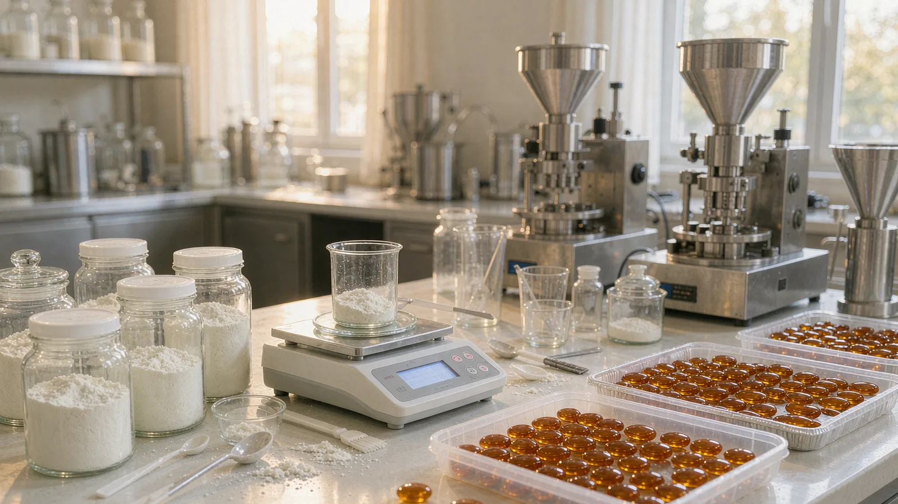
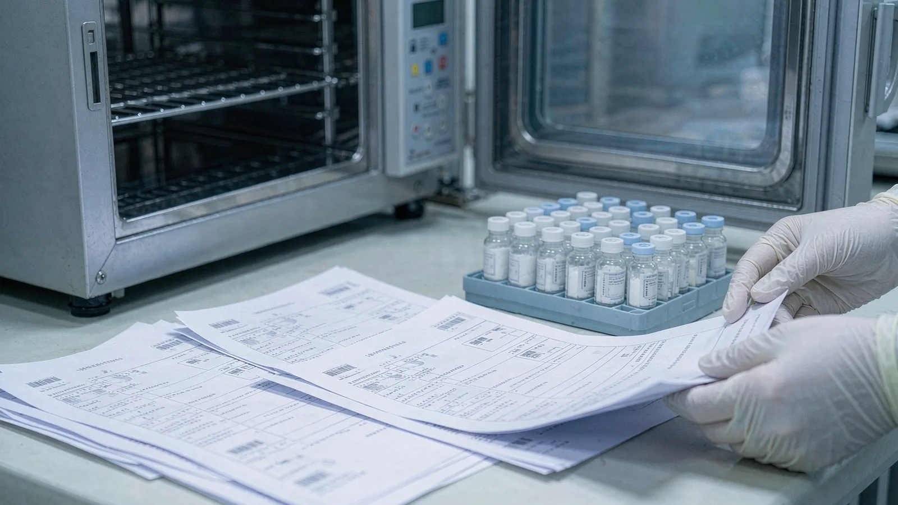

# Phosphatidylserine for Children's & Prenatal Formulations: Sourcing & Compliance Guide for US-EU Buyers

## Publishing Note

- Target publish date: 2026-11-11
- Site: nutranexaps.com (Nutranexa — phosphatidylserine B2B ingredient supply)
- Audience: supplement brand owners, product developers and procurement teams planning children's or prenatal products containing phosphatidylserine (PS)
- Word count target: 1,200–1,500 (body)
- Images: ps-children-prenatal-sourcing-main.webp (early section), ps-children-prenatal-sourcing-detail.webp (later section)
- Disclaimer: prepared by content operations for B2B sourcing information only; this article is not medical, legal or regulatory advice. Consult qualified regulatory and clinical professionals before launching pediatric or prenatal formulations.

## Topic Planning Notes

- Cluster: PS sourcing/quality/OEM — pediatric and prenatal application-specific sourcing, a population segment not yet covered by existing articles (the infant-formula article addresses a distinct regulatory category).
- Search intent: buyers searching for how PS sourcing, specification and documentation differ when the finished product targets children or pregnant women — doses, allergen choices, tighter contaminant limits, claim limitations.
- Angle rationale: competitive moat is compliance and document depth; pediatric/prenatal programs amplify every sourcing decision (source material, spec limits, format). This article converts general PS procurement knowledge into population-specific operational guidance.

## SEO Keywords

- primary: phosphatidylserine children's supplement sourcing
- secondary: phosphatidylserine prenatal supplement ingredient, soy-free sunflower phosphatidylserine kids, PS specification pediatric formulation, phosphatidylserine heavy metals children's supplement, prenatal PS dosage form OEM
- long-tail: how to source phosphatidylserine for a children's chewable, phosphatidylserine dose for kids supplement, soy vs sunflower PS for prenatal vitamins, documentation for pediatric PS formulation US EU

## SEO Metadata

- SEO Title: Phosphatidylserine for Children's & Prenatal Formulations: Sourcing Guide | Nutranexa
- Meta Description: How PS sourcing changes for children's and prenatal products — doses, soy vs sunflower, tighter specs and the US-EU documents pediatric programs need.
- URL Slug: /resources/phosphatidylserine-children-prenatal-formulation-sourcing-us-eu/
- H1: Phosphatidylserine for Children's & Prenatal Formulations: Sourcing & Compliance Guide for US-EU Buyers

## Outline

1. Introduction — why pediatric and prenatal programs raise the stakes on every sourcing decision
2. Why children's and prenatal programs change the sourcing equation
3. Dose, format and grade selection for pediatric and prenatal products
4. Soy vs sunflower source material for kids' and prenatal labels
5. Specifications and testing that tighten for pediatric applications
6. Regulatory positioning and documentation for US and EU launches
7. FAQ
8. Conclusion

## Introduction

Children's cognitive-support supplements and prenatal nutrition lines are among the fastest-growing categories in both the US and EU markets, and phosphatidylserine is increasingly specified for both. The ingredient's published research base — including trials in children at 100–300 mg/day — gives formulators a defensible reason to include it, and the dose range fits the chewable, gummy and stick-pack formats that dominate the kids' shelf. But a pediatric or prenatal label does not just add a market segment: it raises the stakes on every sourcing decision you have already made, from source material to contaminant limits to claim language.

The operational difference is concentration of risk. A children's product with a heavy-metal excursion is a fundamentally different event than the same excursion in an adult sports product; an allergen misdeclaration on a kids' SKU can force a school-facing recall. Parents read panels closely, retailers apply their own pediatric sourcing standards, and regulators treat young populations with proportionally greater caution. Your supplier's specification sheet, certificate of analysis discipline and change-notification behavior therefore matter more, not less, when the end user is a child or an expectant mother. This guide walks through what actually changes: grade and format selection, the soy-versus-sunflower decision, tightened specifications, and the US-EU document set that keeps the program audit-ready.

If your label strategy targets the growing share of parents who actively avoid soy and major allergens, locking the material against a [soy-free sunflower-derived phosphatidylserine grade](/products/sunflower-phosphatidylserine/) is the cleanest starting point for a children's or prenatal SKU.

## Main Content

### Why Children's and Prenatal Programs Change the Sourcing Equation

For an adult nootropic, a supplier's standard commercial specification usually defines the program. For a children's or prenatal product, the sourcing conversation starts earlier and reaches deeper into the supplier's quality system. The reasons are structural. First, acceptable daily exposure margins are smaller: a contaminant that is unremarkable at a 5 g serving of an adult blend becomes material at a 300 mg children's dose multiplied by daily use over years. Second, the audience cannot read labels for themselves — parents make purchase decisions on trust signals, and an allergen statement that is ambiguous rather than negative loses the sale. Third, retailers and e-commerce platforms increasingly request pediatric-specific documentation, from allergen verification to heavy-metal panels, before listing kids' products.

The supplier-selection consequence is that pediatric and prenatal programs should be qualified against stricter criteria than your adult lines: lower agreed heavy-metal limits in the purchase specification, allergen programs verified with testing rather than statements alone, and faster formal change-notification commitments. If your supplier hesitates at any of these, the friction will surface exactly when the program is most visible — at retailer onboarding, during a platform audit, or in the first parent-facing recall inquiry. The encouraging part is that the cost of tighter requirements is modest for a capable supplier: a factory already controlling cross-contact and running per-lot contaminant panels can simply write the pediatric limits down and hold them. The screening question, therefore, is not whether the supplier can meet your numbers but whether their quality system is stable enough to guarantee the same numbers lot after lot, year after year, without renegotiation. That is a process-capability question, and it deserves the same rigor in your qualification file as the assay itself.

### Dose, Format and Grade Selection for Pediatric and Prenatal Products

Published pediatric research on PS sits mostly in the 100–300 mg/day range, which defines both the label claim territory and the formulation math. At those low doses, delivering the claim accurately is a homogeneity problem: a 300 mg dose in a 1.5 g gummy means PS is only 20% of the mass, and a 50% PS powder on a carrier is usually the practical grade choice, because it doses and blends more evenly than a 70% concentrate and leaves headroom for flavor systems. For prenatal capsules, a 70% concentrate may still make sense to keep the per-capsule mass reasonable alongside the vitamin-mineral premix.

Format drives the rest of the spec. Children's formats — gummies, chewables, stick packs, low-dose liquids — expose PS to heat, shear and flavor systems that powders in capsules never meet, so taste-masking and oxidative stability join the critical conversation, and the carrier system must survive the process. The format-level trade-offs mirror those in our [gummy formulation review](/resources/phosphatidylserine-gummies-formulation-us-eu/), where dose homogeneity and taste carry the program. Prenatal programs face a different constraint: PS must coexist with iron, calcium and other minerals in the premix, and excipient-compatibility work before scale-up prevents assay drift discovered late.

<!-- Embedded CTA Box: Sample & Spec Match -->
<aside style="margin:36px 0;padding:24px 28px;background:#f5f8fc;border:1px solid #d7e0ec;border-left:4px solid #102a56;border-radius:3px;font-family:Arial,Helvetica,sans-serif;color:#1a2433;">

Factory Direct · Specification Review

<h3 style="font-family:Arial,Helvetica,sans-serif;font-size:22px;font-weight:700;margin:0 0 10px 0;color:#102a56;">Validating a Phosphatidylserine Grade Before Your First Order?</h3>

Send your current specification, target assay and application. We review grade, source (soy or sunflower), concentration and documentation against your programme, then ship samples with a lot-specific certificate of analysis for validation on your own line.

<a href="/contact/" style="display:inline-block;padding:11px 22px;background:#102a56;color:#fff;font-weight:700;font-size:14px;text-decoration:none;border-radius:2px;">Request Samples &amp; Spec Review →</a>
<a href="/products/phosphatidylserine/" style="display:inline-block;padding:11px 22px;background:#fff;color:#102a56;border:1px solid #102a56;font-weight:700;font-size:14px;text-decoration:none;border-radius:2px;">View Product Specifications</a>

</aside>

### Soy vs Sunflower Source Material for Kids' and Prenatal Labels

Soy-derived PS remains the volume and cost benchmark, but a children's or prenatal label changes the calculus. Soy is a major allergen in both the US (FDA "Big 9") and EU (Annex II) frameworks, and parents of young children are the most allergen-sensitive consumer segment in the market. A "contains soy" panel on a kids' chewable narrows retail distribution and invites questions at exactly the moment your brand wants none. Sunflower-derived PS removes the soy allergen declaration entirely, supports a soy-free front-of-pack position, and for most pediatric SKUs the modest premium is commercially trivial against the price points children's products command.

The sourcing discipline is the same either way: the allergen program must be documented, not implied. Ask for the allergen statement, allergen cross-contact controls, and — for soy-free claims on sunflower material — confirm the supplier's position on soy lecithin carriers or shared lines, because a soy-free claim built on a soy-processed material is a recall waiting for an auditor. Our comparison of [soy versus sunflower allergen positioning](/resources/soy-vs-sunflower-phosphatidylserine-allergen-positioning/) covers the label mechanics in depth.

### Specifications and Testing That Tighten for Pediatric Applications

A pediatric program should not inherit the adult line's specification unchanged. The parameters that deserve tightening:

- Heavy metals: negotiate lower limit values for lead, cadmium, arsenic and mercury in the purchase specification and verify each lot on the COA — agreed limits, not just method detection limits, are what protect the claim you will publish
- Peroxide value and oxidative markers: children's formats are oxidatively harsher; set tighter internal action limits than the supplier's standard sheet
- Microbiological limits: standard for adults, but confirm the panel covers the organisms your contract manufacturer's QA will ask about for kids' products
- Allergen verification: negative statements plus periodic testing, particularly if the line runs in a facility handling soy
- Identity and assay: fatty-acid-profile identity testing plus HPLC assay per lot, because the dose is small and assay error is proportionally large

Each of these is a negotiation, not a request — our walkthrough of [heavy metals specification negotiation](/resources/phosphatidylserine-heavy-metals-spec-negotiation-us-eu/) shows how buyers convert tighter limits into contract terms without losing supply flexibility.

### Regulatory Positioning and Documentation for US and EU Launches

In the US, PS in a children's supplement is positioned like any dietary ingredient: structure-function claims with the standard disclaimer, no disease claims — and for pediatric products, no claims that imply treatment of childhood conditions. Claims language for kids draws disproportionate FDA and platform attention, so keep the label and listing consistent with the ingredient's history in supplements. Note that infant formula is a separate regulatory category with its own rules — a distinction our [infant formula regulatory review](/resources/phosphatidylserine-infant-formula-regulatory-review-us-eu/) explains — while children's and prenatal products follow the general dietary-supplement framework.

In the EU, the product enters under national food-supplement law harmonized by Directive 2002/46/EC, with notification per member state; permitted claims must come from the EU Register, and children's claim territory is narrower than adults'. Prenatal positioning in both markets should be conservative: the evidence base for PS in pregnancy is thinner than for children and adults, so formulation teams typically keep prenatal claims to general nutritional support language. Across both jurisdictions, the document pack your supplier must sustain is identical: specification, lot COA, allergen and GMO statements, process summary and stability data. Review that pack critically rather than filing it — the discipline of reading COAs for internal inconsistencies, described in our [COA red flags audit guide](/resources/phosphatidylserine-coa-red-flags-audit-us-eu/), is doubly valuable when the customer is a parent trusting your panel.

<!-- Embedded CTA Box: Compliance & Documentation -->
<aside style="margin:36px 0;padding:26px 28px;background:#102a56;color:#eef2f8;border-radius:3px;font-family:Arial,Helvetica,sans-serif;">

Compliance &amp; Documentation

<h3 style="font-family:Arial,Helvetica,sans-serif;font-size:22px;font-weight:700;margin:0 0 10px 0;color:#fff;">Need COAs, SDS or Market-Specific Compliance Files?</h3>

Every shipment ships with a certificate of analysis and a safety data sheet, and market documentation is prepared per destination — US, EU and APAC programmes each carry their own declaration set. Ask for the document package behind any grade before committing volume.

<a href="/contact/" style="display:inline-block;padding:11px 22px;background:#c69a35;color:#102a56;font-weight:700;font-size:14px;text-decoration:none;border-radius:2px;">Request the Document Package →</a>
<a href="/resources/documents-for-ps-ingredients/" style="display:inline-block;padding:11px 22px;background:transparent;color:#fff;border:1px solid rgba(255,255,255,0.4);font-weight:700;font-size:14px;text-decoration:none;border-radius:2px;">See the Document Checklist</a>

</aside>

## FAQ

### What PS dose do children's supplements typically carry?

Published pediatric studies used roughly 100–300 mg/day, and commercial children's products generally stay in that band. The dose you can claim is a label and legal decision, but the sourcing consequence is fixed: low doses favor 50% PS powders on carriers for blend homogeneity in gummies, chewables and stick packs.

### Is soy-derived PS acceptable for a children's product?

Legally yes, with a "contains soy" declaration, since soy is a major allergen in the US and EU. Commercially it costs you: allergen-sensitive parents, school-facing policies and retailer screening all penalize soy labels in the kids' category. Most children's and prenatal SKUs specify sunflower-derived PS to avoid the declaration entirely.

### What extra testing should I require for a pediatric PS program?

At minimum: heavy metals (Pb, Cd, As, Hg) per lot at limits tighter than the adult spec, peroxide value with internal action limits, the full microbiological panel, allergen verification with periodic testing for soy-free claims, and HPLC assay plus fatty-acid identity per lot. Put the limits in the purchase specification, not just the supplier's standard sheet.

### Can I make cognitive claims on a prenatal PS product?

Keep it conservative. The US framework allows structure-function language with a disclaimer but no disease claims, and for pregnancy the credible territory is general nutritional support. In the EU, only authorized claims from the EU Register are available, and pregnancy-specific claim territory is narrow. Build claims with your regulatory counsel before locking artwork.

## Conclusion

Sourcing phosphatidylserine for children's and prenatal products is not a new procurement process — it is the same process with every tolerance tightened and every document made non-negotiable. Choose the source material against your allergen label strategy, set contaminant limits that reflect a pediatric exposure profile, select the grade for the format's homogeneity and stability realities, and keep the claim language inside what the ingredient's regulatory history supports. Suppliers who can hold tighter agreed limits, verify allergen programs with testing and notify changes formally are worth qualifying early, because pediatric programs amplify every weakness in the supply chain. If you are scoping a children's chewable or a prenatal line, [review Nutranexa's manufacturing and quality capabilities](/manufacturing/) and we will align the grade, document pack and pediatric-appropriate specification before your first pilot batch.

## Sources

- US FDA — Dietary Supplements (regulatory framework and labeling): https://www.fda.gov/food/dietary-supplements
- US FDA — Structure/Function Claims for dietary supplements: https://www.fda.gov/food/information-consumers-using-dietary-supplements
- EU Directive 2002/46/EC on food supplements (Eur-Lex consolidated text): https://eur-lex.europa.eu/legal-content/EN/TXT/?uri=CELEX:32002L0046
- EFSA — Food supplements topic page: https://www.efsa.europa.eu/en/topics/topic/food-supplements
- NIH Office of Dietary Supplements — Dietary Supplement Label Database: https://dsld.od.nih.gov/
- Hirayama S. et al., "The effect of phosphatidylserine administration on memory in children" (2014), Journal of Nutritional Science and Vitaminology: https://www.jstage.jst.go.jp/article/jnsv/60/4/60_247/_article

## CTA

Planning a children's or prenatal phosphatidylserine formulation? Request a pediatric-appropriate specification and document pack — sunflower or soy grade options, lot COA, allergen and contaminant data — from Nutranexa before your pilot. Reach us at /contact/ for samples and sourcing support.
