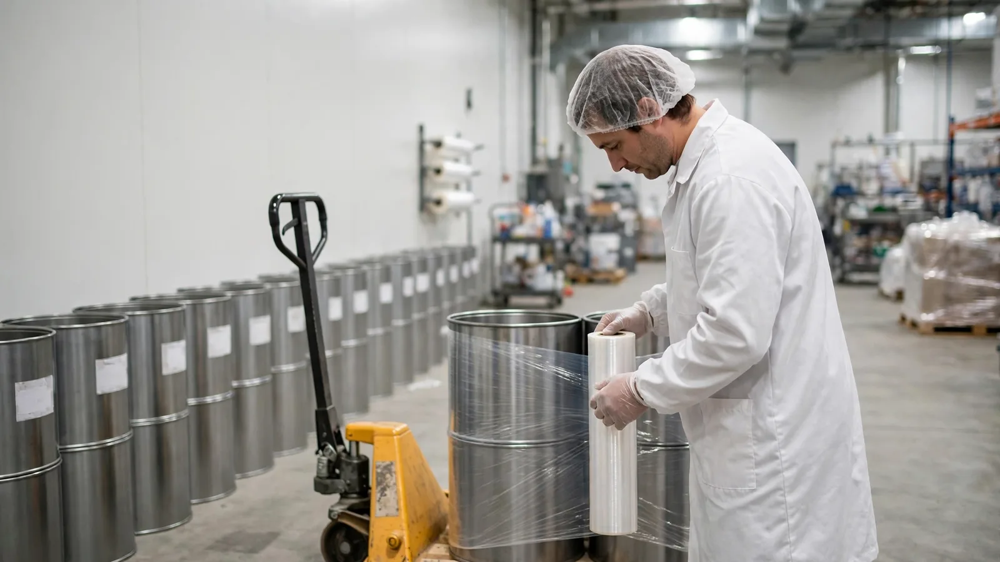
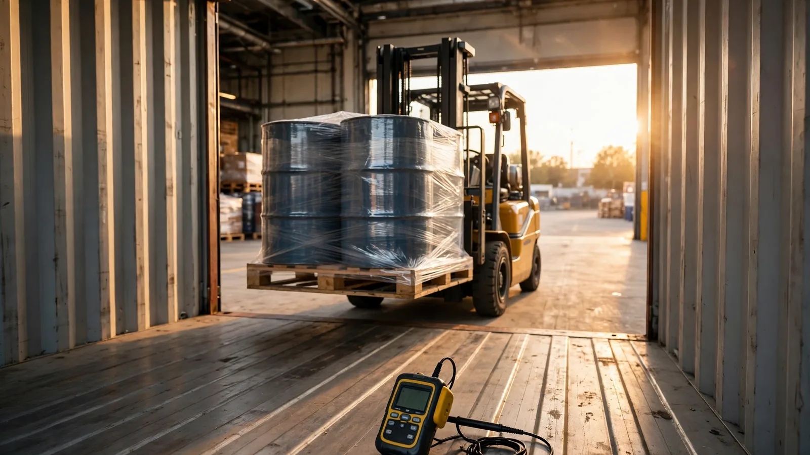

# Phosphatidylserine Export Packaging Qualification: Validating Drums, Pallets and Container Loading Before Your First Bulk Shipment (US & EU)

## Publishing Note

- Site: nutranexaps (Nutranexa — B2B phosphatidylserine ingredient supplier)
- Target audience: procurement teams, logistics managers and QA staff qualifying export packaging and shipping lanes for bulk phosphatidylserine powder in the US and EU
- Publish date: 2026-11-22
- Author: Nutranexa technical sourcing desk
- Internal assets referenced: two webp images (generated separately)

## Topic Planning Notes

- Rationale: the library already compares bulk packaging options, drum selection, nitrogen-flush specification, ISPM 15 paperwork and container loading as separate topics, but no article assembles them into a single pre-shipment qualification programme: how a buyer verifies that the chosen drum, liner, pallet and container configuration actually protects PS powder through a specific ocean lane before the first commercial order. The qualification-process angle sits between the packaging comparison articles and the damage-claims articles, so it fills a process gap without cannibalising them, and links to them as companion reading.
- Dedup check: grepped `packaging qualification`, `export packaging`, `lane validation`, `first shipment`, `drum`, `container loading` across D:\Projects\nutranexaps\content\resources\ and the pipeline queue. All matches are passing mentions or single-topic deep-dives (bulk packaging options comparison, drum selection, nitrogen-flush spec, ISPM 15 export documentation, container loading procedure, freight damage claims, cold-chain validation). No article carries a packaging-qualification primary keyword, slug, SEO Title or H1. Slug `phosphatidylserine-export-packaging-qualification-us-eu` has zero collision in repo and queue. Excluded angles (soy vs sunflower sourcing decision, COA document audit, per-format OEM minimum orders, bulk density spec, Indonesia/Philippines/Korea/China market entry, functional food sourcing, healthy aging, carrier systems, acceptance specification panel) are already covered or queued and were rejected.
- Buyer intent: defining packaging acceptance criteria for a PS export lane, verifying supplier drum and container configuration before the first bulk order, and setting up first-shipment validation.

## SEO Keywords

- phosphatidylserine export packaging qualification
- PS bulk powder export drum liner specification
- phosphatidylserine container loading ocean freight validation
- phosphatidylserine shipping lane qualification US EU
- PS export palletisation desiccant data logger
- phosphatidylserine first shipment packaging verification

## SEO Metadata

- SEO Title: Phosphatidylserine Export Packaging Qualification: A Pre-Shipment Buyer's Guide (US & EU)
- Meta Description: Qualify phosphatidylserine export packaging before your first bulk order: drum and liner checks, palletisation, container loading, data loggers and first-shipment validation for US and EU lanes.
- URL Slug: /resources/phosphatidylserine-export-packaging-qualification-us-eu/
- H1: Phosphatidylserine Export Packaging Qualification: Validating Drums, Pallets and Container Loading Before Your First Bulk Shipment (US & EU)

## Outline

1. Why packaging needs qualification, not just selection
2. The primary pack: drum, liner, seal and headspace
3. Palletisation and container loading: the physical layer
4. Monitoring the lane: temperature, humidity and data loggers
5. First-shipment validation and the feedback loop
6. FAQ, conclusion, sources

## Introduction

Bulk phosphatidylserine is unusually unforgiving cargo for a powder ingredient: it is oxidation-sensitive, hygroscopic enough to matter, and it often crosses an equator or two between the production site and a US or EU warehouse. Yet packaging decisions are usually made once, at quotation stage, from whatever export set the supplier uses by default — and then never re-examined until a drum arrives dented, caked or oxidised. The gap between "a packaging option was chosen" and "the packaging was qualified for this lane" is where most first-shipment losses live. Qualification means verifying, before the commercial order, that the drum and liner specification, the pallet configuration, the container preparation and the monitoring plan work together for your specific route, season and destination climate. This article walks through that programme layer by layer: the primary pack, the physical load, the in-transit monitoring and the first-shipment validation that turns a one-off shipment into a repeatable lane. For the product side of that readiness, review [the export-grade phosphatidylserine powder specifications](/products/phosphatidylserine/) Nutranexa ships against before locking a packaging configuration.

## Main Content

### Why Packaging Needs Qualification, Not Just Selection

Selecting packaging answers one question: which drum, liner and pallet type will you use? Qualification answers a different question entirely: does that configuration survive your lane — the actual ports, transhipments, seasons and warehouse climates between the supplier and you? A drum set that performs on a four-week temperate route into Rotterdam can fail on a six-week summer route with a Middle East transhipment, and nothing on a datasheet will tell you so. The distinction matters because packaging failures in phosphatidylserine rarely look like catastrophic damage. They look like a peroxide value that drifts faster than the stability study assumed, a powder that has picked up moisture in a humid hold, or a liner seal that opened a few centimetres under vibration and let the powder shift. Each of these passes a casual visual inspection at discharge and surfaces weeks later in your incoming testing — by which time the root cause is buried in a transit you never instrumented. A qualification programme closes that gap by testing assumptions in advance and instrumenting the first real shipments, so that lane risk is measured rather than inherited.

### The Primary Pack: Drum, Liner, Seal and Headspace

Start at the drum, because everything above it inherits its weaknesses. The qualification questions are concrete: what is the drum construction and rating, what is the liner material and thickness, how is the liner closed, and what headspace gas — nitrogen flush or air — is declared on the specification? Each answer should appear in writing, because verbal descriptions of "food-grade drums with foil liner" cannot be audited when a lot arrives out of trend. Ask for the liner's oxygen and moisture barrier properties and how the closure is verified at packing; a liner that is folded but not sealed behaves very differently from a heat-sealed one on a long ocean leg. Desiccant placement and quantity belong in the same written set, along with whether oxygen absorbers are used and how headspace is controlled after nitrogen flush. None of this is exotic — it is the difference between a specification you can hold a supplier to and a description you can only argue about. The trade-offs between drum types, liner materials and sizes are mapped in detail elsewhere, so before locking the primary pack, compare the options systematically in [our phosphatidylserine bulk packaging options comparison](/resources/phosphatidylserine-bulk-packaging-options-comparison-us-eu/) and then qualify the chosen set for your lane.

<!-- Embedded CTA Box: Sample & Spec Match -->
<aside style="margin:36px 0;padding:24px 28px;background:#f5f8fc;border:1px solid #d7e0ec;border-left:4px solid #102a56;border-radius:3px;font-family:Arial,Helvetica,sans-serif;color:#1a2433;">

Factory Direct · Specification Review

<h3 style="font-family:Arial,Helvetica,sans-serif;font-size:22px;font-weight:700;margin:0 0 10px 0;color:#102a56;">Validating a Phosphatidylserine Grade Before Your First Order?</h3>

Send your current specification, target assay and application. We review grade, source (soy or sunflower), concentration and documentation against your programme, then ship samples with a lot-specific certificate of analysis for validation on your own line.

<a href="/contact/" style="display:inline-block;padding:11px 22px;background:#102a56;color:#fff;font-weight:700;font-size:14px;text-decoration:none;border-radius:2px;">Request Samples &amp; Spec Review →</a>
<a href="/products/phosphatidylserine/" style="display:inline-block;padding:11px 22px;background:#fff;color:#102a56;border:1px solid #102a56;font-weight:700;font-size:14px;text-decoration:none;border-radius:2px;">View Product Specifications</a>

</aside>

### Palletisation and Container Loading: The Physical Layer

Above the drum sits the load, and the load is where mechanical damage and climate exposure actually happen. Qualify the pallet configuration in writing: drum weight per pallet, stretch-wrap and strapping method, top and side protection, and whether drums are loaded on their base or in any other orientation. ISPM 15-compliant pallets and dunnage should be a documented given, not an assumption. Then qualify the container itself: an inspection routine before loading — cleanliness, dryness, floor condition, door seals — costs minutes and prevents the most common moisture failures, because a damp container floor will wick into kraft packaging over five weeks at sea regardless of how good the liner is. Loading pattern matters too: drums braced against longitudinal and lateral movement survive rail segments and heavy-weather rolling that unbraced drums do not, and a shifted stack that only dents a drum wall can still compromise the liner seal inside it. When the packing list, loading photos and container inspection are required as shipment documents, the physical layer becomes auditable — and disputes, when they occur, become resolvable rather than speculative.

### Monitoring the Lane: Temperature, Humidity and Data Loggers

An uninstrumented shipment is a rumour; an instrumented one is evidence. For a qualified lane, place calibrated temperature and humidity loggers inside at least one drum per shipment and in the container itself, with positions agreed in advance and recovery instructions written into the shipping documents. The first commercial shipments should always be instrumented even if later routine shipments are not, because the data does two jobs: it verifies that the packaging system held the environment the stability study assumed, and it builds a lane profile you can negotiate from. Review the traces against expectations — peak temperature on the equatorial leg, humidity spikes during transhipment, the gradient between container air and drum interior — rather than just checking whether anything "went wrong". A trace that shows a controlled, expected profile is qualification evidence; a trace with unexplained excursions is a conversation with the supplier about routing, season or packaging upgrades before you commit annual volume. For what those excursions look like when the controls fail and how to respond commercially, see [the temperature excursion logistics review for phosphatidylserine](/resources/phosphatidylserine-temperature-excursion-logistics-us-eu/).

### First-Shipment Validation and the Feedback Loop

Qualification ends with a decision, and that decision should be explicit. Treat the first commercial shipment as a validation article: incoming testing against the full acceptance specification, logger traces reviewed and filed, drum condition photographed at discharge, liner seals checked before sampling. If the shipment passes cleanly, the lane is qualified — record the configuration, the season and the evidence, and make any deviation from that configuration a change-notification trigger in the supplier quality agreement. If it does not, the instrumentation tells you which layer failed: moisture ingress points to container or liner, oxidation drift points to headspace or barrier, mechanical damage points to palletisation or handling. Fix at the failing layer, then re-validate rather than assuming the fix worked. Over two or three shipments this loop converts an unknown lane into a known one, and the written record becomes your leverage in pricing, lead-time and claim discussions. Qualification is not paperwork for its own sake; it is the mechanism that makes every subsequent phosphatidylserine order on that lane boring — which, in ingredient logistics, is the highest compliment a lane can earn.

<!-- Embedded CTA Box: Compliance & Documentation -->
<aside style="margin:36px 0;padding:26px 28px;background:#102a56;color:#eef2f8;border-radius:3px;font-family:Arial,Helvetica,sans-serif;">

Compliance &amp; Documentation

<h3 style="font-family:Arial,Helvetica,sans-serif;font-size:22px;font-weight:700;margin:0 0 10px 0;color:#fff;">Need COAs, SDS or Market-Specific Compliance Files?</h3>

Every shipment ships with a certificate of analysis and a safety data sheet, and market documentation is prepared per destination — US, EU and APAC programmes each carry their own declaration set. Ask for the document package behind any grade before committing volume.

<a href="/contact/" style="display:inline-block;padding:11px 22px;background:#c69a35;color:#102a56;font-weight:700;font-size:14px;text-decoration:none;border-radius:2px;">Request the Document Package →</a>
<a href="/resources/documents-for-ps-ingredients/" style="display:inline-block;padding:11px 22px;background:transparent;color:#fff;border:1px solid rgba(255,255,255,0.4);font-weight:700;font-size:14px;text-decoration:none;border-radius:2px;">See the Document Checklist</a>

</aside>

## FAQ

### Q: What should a phosphatidylserine packaging qualification include at minimum?

A: At minimum: a written drum and liner specification with closure and headspace details, a palletisation and container-loading procedure with pre-loading container inspection, agreed temperature and humidity logger placement for validation shipments, and a defined incoming-test review of the first commercial lots. Each element should be documented so deviations trigger change notification rather than argument.

### Q: Do we need data loggers on every shipment?

A: Not necessarily. Instrument the first shipments and any shipment on a new lane, season or packaging configuration. Once a lane is qualified with clean traces, periodic or exception-based monitoring is usually sufficient — but define the trigger conditions in advance, such as a routing change or a seasonal peak-heat window.

### Q: Is nitrogen flush enough to protect PS powder at sea?

A: Nitrogen flush reduces headspace oxygen at packing, but it is only one layer. Barrier properties of the liner, seal integrity under vibration, moisture control and container condition all interact with it. A drum flushed with nitrogen but loaded into a damp container can still fail on moisture; qualification exists precisely to check the layers together rather than trusting any single one.

### Q: When should a qualified packaging configuration be re-validated?

A: On any defined trigger: a change of drum or liner supplier, a routing or port change, a season outside the qualified window, or an incoming result trending against expectation. Otherwise a periodic review — annually or at contract renewal — with the filed logger traces and incoming data is usually enough.

## Conclusion

Packaging qualification is the quiet discipline that separates a lane you hope works from a lane you can prove works. Written drum and liner specifications, an auditable load, instrumented validation shipments and an explicit pass-or-fix decision turn transit risk from an inherited unknown into a managed variable — and they cost far less than one rejected container of oxidised powder. Build the programme once, tie deviations to change control, and every subsequent order inherits the evidence instead of the risk. When you are ready to qualify a packaging configuration for your own lane, [talk to the Nutranexa export team](/contact/) for drum specifications, loading documentation and the monitoring plan behind each shipment.

## Sources

1. [ISTA — International Safe Transit Association (transit performance testing standards for packaged products)](https://www.ista.org/)
2. [IPPC — ISPM 15 (regulation of wood packaging material in international trade)](https://www.ippc.int/en/core-activities/standards-setting/ispm15/)
3. [FDA — Sanitary Transportation of Human and Animal Food (FSMA rule framework for food transport conditions)](https://www.fda.gov/food/food-safety-modernization-act-fsma/fda-food-safety-modernization-act-fsma)
4. [PubMed — search: phosphatidylserine oxidative stability packaging](https://pubmed.ncbi.nlm.nih.gov/?term=phosphatidylserine+oxidative+stability)

## CTA

Nutranexa supplies soy-derived and sunflower-derived phosphatidylserine in 20, 50 and 70 percent grades in qualified export packaging, with written drum and liner specifications, loading documentation, logger-supported lane validation and lot-specific certificates of analysis. Contact us for a packaging qualification review or the full export document package for your next bulk order.
