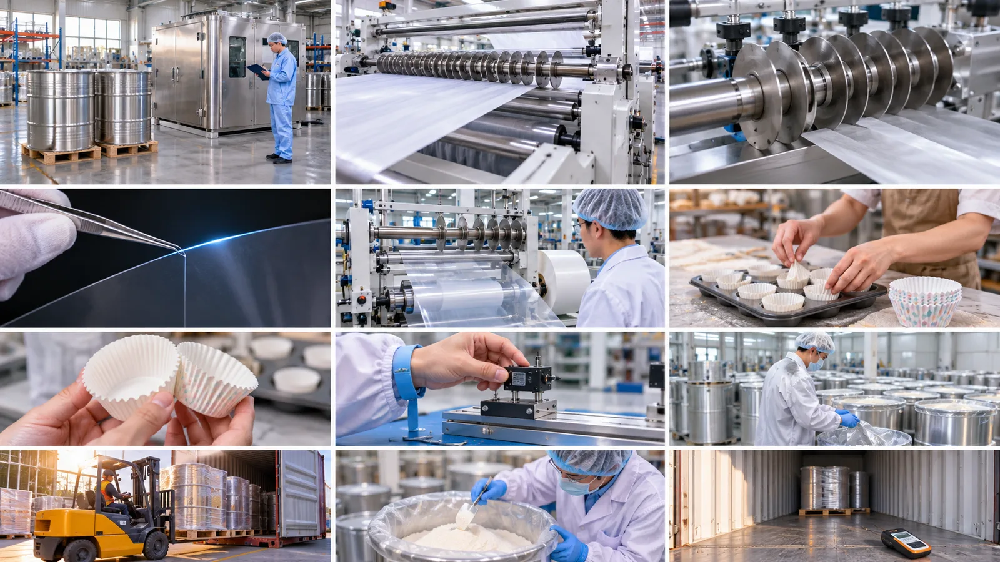

# Phosphatidylserine Powder Caking: Storage and Handling Requirements Buyers Should Specify (US & EU)

## Publishing Note

- Site: nutranexaps (Nutranexa — B2B phosphatidylserine ingredient supplier)
- Target audience: procurement teams, warehouse and QA managers handling bulk phosphatidylserine powder after arrival in the US and EU
- Publish date: 2026-11-23
- Author: Nutranexa technical sourcing desk
- Internal assets referenced: two webp images (generated separately)

## Topic Planning Notes

- Rationale: the library covers flowability for OEM blend uniformity, moisture and water activity as specification documents, warehouse storage management at inventory level and packaging qualification for transit — but no article addresses caking itself as a physical outcome: why phosphatidylserine powder cakes, how transit and the buyer's own warehouse contribute, and which storage and handling requirements a buyer should put in writing before the first order. This handling-requirements angle sits between the specification-review articles and the warehouse-management article without cannibalising them, and links to both as companion reading.
- Dedup check: grepped `caking`, `anti-caking`, `flowability`, `storage and handling` across D:\Projects\nutranexaps\content\resources\ and the pipeline queue. All matches are passing mentions or adjacent single-topic deep-dives (flowability in blend-uniformity pilots, moisture/water activity document review, warehouse storage and shelf-life management, acceptance specification panel, bulk and tapped density). No article carries a caking primary keyword, slug, SEO Title or H1. Slug `phosphatidylserine-powder-caking-storage-handling-us-eu` has zero collision in repo and queue. Excluded angles (COA red-flag audits, soy vs sunflower allergen positioning, acceptance specification panel, bulk vs tapped density, carrier vs carrier-free OEM, market-entry guides for Thailand/China/Indonesia/Philippines/Korea, certificate of free sale, healthy aging sourcing, functional food sourcing, export packaging qualification) are already covered in the repo or queue and were rejected.
- Buyer intent: understanding why PS powder cakes, defining written storage and handling requirements for supplier and own warehouse, and deciding how to treat a caked lot on arrival.

## SEO Keywords

- phosphatidylserine powder caking
- PS powder storage and handling requirements
- phosphatidylserine drum opened handling warehouse humidity
- phosphatidylserine powder caked lot acceptance
- PS powder hygroscopic handling specification
- phosphatidylserine warehouse storage conditions buyers specify

## SEO Metadata

- SEO Title: Phosphatidylserine Powder Caking: Storage & Handling Requirements Buyers Should Specify
- Meta Description: Why phosphatidylserine powder cakes in transit and storage, and the written storage and handling requirements — warehouse humidity, opened-drum rules, partial-lot control — US and EU buyers should specify before ordering.
- URL Slug: /resources/phosphatidylserine-powder-caking-storage-handling-us-eu/
- H1: Phosphatidylserine Powder Caking: Storage and Handling Requirements Buyers Should Specify (US & EU)

## Outline

1. Why caking is a handling outcome, not just a supplier failure
2. What makes phosphatidylserine powder cake
3. Specifying storage and handling requirements in the purchase specification
4. Warehouse handling requirements after the drum is opened
5. Accepting, remediating or rejecting a caked lot
6. FAQ, conclusion, sources

## Introduction

Few things alarm an incoming-QC team faster than opening a drum of phosphatidylserine powder and finding it has set into a solid block. Caking looks like a supplier failure, and sometimes it is — but in practice it is usually the product of an interaction: a hygroscopic phospholipid powder, a transit season, a packaging headspace, and then weeks of handling in the buyer's own warehouse that nobody ever specified. That last layer is the one most programmes ignore. Suppliers ship against written specifications, yet the conditions the powder meets after discharge — warehouse humidity, how long drums stay open, whether partial lots are re-sealed — are often governed by habit rather than contract. This article explains the caking mechanism in PS powder specifically, then walks through the storage and handling requirements a US or EU buyer should specify in writing, on both sides of the transaction. Start from the material itself: the [export-grade phosphatidylserine powder specifications](/products/phosphatidylserine/) that define the physical behaviour your handling plan has to protect.

## Main Content

### Why Caking Is a Handling Outcome, Not Just a Supplier Failure

When a caked lot arrives, the instinct is to open a claim. Sometimes that is right — a leaking liner, a missing desiccant or a moisture excursion in transit will cake any phospholipid powder. But the same drum shipped to two buyers can produce two different outcomes, because what happens after discharge differs. One warehouse stores drums in a dehumidified room and works through them on a fixed schedule; another keeps them on an ambient dock and leaves a drum open until the order pick is complete. Six weeks later, only one of those lots still flows. Caking in PS powder is rarely a single-cause event: it is moisture meeting time under pressure, and both variables are controlled partly by the supplier and partly by the buyer. That is why handling requirements belong in the purchase specification, not in a claim dispute. A buyer who specifies storage conditions contractually can distinguish a supplier-side failure from a handling-side one — and can prevent most caking events from happening at all.

### What Makes Phosphatidylserine Powder Cake

Phosphatidylserine powder is a phospholipid system, usually spray-dried onto or blended with a carrier, and phospholipids are hygroscopic by nature: exposed to humid air, the powder surface picks up moisture, particles at contact points soften and dissolve microscopically, and as moisture redistributes and the contact points re-solidify, bridges form between particles. Add the static load of a half-tonne pallet stack and drum vibration from an ocean leg, and those bridges mature into a coherent mass. Three variables drive how far this goes. Moisture input: the water activity of the powder as packed, the barrier of the liner, headspace conditions and every hour the drum stands open. Temperature cycling: diurnal swings in an ambient warehouse move moisture within the drum as warm air expands and cool air contracts, depositing condensation on the powder surface nearest the wall. Time under load: the bottom of a drum that sits untouched for months cakes further than the top. None of these mechanisms shows up on a certificate of analysis — which is precisely why handling, not just testing, determines whether the powder you receive is the powder you ship to your own customers.

<!-- Embedded CTA Box: Sample & Spec Match -->
<aside style="margin:36px 0;padding:24px 28px;background:#f5f8fc;border:1px solid #d7e0ec;border-left:4px solid #102a56;border-radius:3px;font-family:Arial,Helvetica,sans-serif;color:#1a2433;">

Factory Direct · Specification Review

<h3 style="font-family:Arial,Helvetica,sans-serif;font-size:22px;font-weight:700;margin:0 0 10px 0;color:#102a56;">Validating a Phosphatidylserine Grade Before Your First Order?</h3>

Send your current specification, target assay and application. We review grade, source (soy or sunflower), concentration and documentation against your programme, then ship samples with a lot-specific certificate of analysis for validation on your own line.

<a href="/contact/" style="display:inline-block;padding:11px 22px;background:#102a56;color:#fff;font-weight:700;font-size:14px;text-decoration:none;border-radius:2px;">Request Samples &amp; Spec Review →</a>
<a href="/products/phosphatidylserine/" style="display:inline-block;padding:11px 22px;background:#fff;color:#102a56;border:1px solid #102a56;font-weight:700;font-size:14px;text-decoration:none;border-radius:2px;">View Product Specifications</a>

</aside>

### Specifying Storage and Handling Requirements in the Purchase Specification

The caking mechanism is only manageable if the conditions around it are written down, and the purchase specification is the place to do it. On the supplier side, require the packed water activity or moisture limit to be stated with its method, the headspace condition (nitrogen flush or air) to be declared, and the storage conditions the supplier warrants — typically a cool, dry area with defined temperature and relative-humidity ceilings — to appear on the specification sheet itself rather than in a brochure. Ask explicitly whether an anti-caking or flow agent is part of the grade, because it changes both the handling plan and the label. On the buyer side, commit to the mirror obligations: receipt into the warranted storage conditions within a defined window, drums kept closed until needed, and a maximum open-drum time agreed in advance. These clauses do two jobs. They make caking root causes auditable on both sides when a lot does arrive hard, and they align the two documents that govern the powder's life — the acceptance criteria you test against and the conditions you store it in. The testing side of that pair, including how moisture and water activity limits are set and reviewed, is covered in detail in [the phosphatidylserine moisture and water activity review](/resources/phosphatidylserine-moisture-water-activity-review-us-eu/).

### Warehouse Handling Requirements After the Drum Is Opened

The opened drum is where most caking risk actually accumulates, and it deserves its own written rule set. Keep drums closed at all times except during active dispensing, and never leave a drum open overnight — an eight-hour exposure to humid air can undo a nitrogen flush that was supposed to last the shelf life. Where partial drums are routine, specify a working practice: dispense in a controlled-humidity area where feasible, expel and re-close the liner promptly, keep desiccant in place and replace it on the supplier's guidance, and set a defined in-use period after which the remainder of an opened drum is consumed, re-tested or discarded. Track opened drums with an in-use label recording the date opened and the planned expiry of the opened portion — most warehouse systems already run this workflow for opened raw materials, and PS belongs in it, not outside it. Stacking rules matter too: drums stored on their base in a moderate stack height keep compaction loads predictable, while deep stacks on soft floors add pressure that accelerates set. These are standard powder-handling hygiene applied to a material that punishes neglect faster than most. How opened and sealed stock fit into the wider inventory picture — rotation, retest dates and shelf-life management — is mapped in [the phosphatidylserine warehouse storage and shelf-life management guide](/resources/phosphatidylserine-warehouse-storage-shelf-life-management-us-eu/).

### Accepting, Remediating or Rejecting a Caked Lot

When powder arrives caked, the decision to accept, remediate or reject should follow a defined path, not a mood. First, distinguish agglomeration from true caking: soft, friable lumps that crumble under light pressure with no visible moisture are often the normal settling behaviour of a phospholipid powder after a long ocean leg, and many grades list acceptable agglomeration in their own specification. True caking — a hard mass, damp texture, colour or odour change — points to moisture ingress and changes the assessment. Second, test rather than look: run the flowability or bulk-density check from your acceptance panel, plus moisture or water activity, and compare against the specification limits rather than the appearance. Third, document both sides: photograph the drums and liners on arrival, retain the logger or carrier data if the lane was instrumented, and notify the supplier within the claim window defined in the quality agreement, so a genuine packaging failure can be separated from warehouse-side exposure. Remediation by gentle, low-force crumbling of soft agglomerates is sometimes acceptable for processing formats; forced milling of a genuinely caked, moisture-loaded lot is not, because the chemical damage has already happened. Every caking event should feed back into the specification: tighten a handling clause, trigger a packaging conversation, or confirm the plan is working.

<!-- Embedded CTA Box: Compliance & Documentation -->
<aside style="margin:36px 0;padding:26px 28px;background:#102a56;color:#eef2f8;border-radius:3px;font-family:Arial,Helvetica,sans-serif;">

Compliance &amp; Documentation

<h3 style="font-family:Arial,Helvetica,sans-serif;font-size:22px;font-weight:700;margin:0 0 10px 0;color:#fff;">Need COAs, SDS or Market-Specific Compliance Files?</h3>

Every shipment ships with a certificate of analysis and a safety data sheet, and market documentation is prepared per destination — US, EU and APAC programmes each carry their own declaration set. Ask for the document package behind any grade before committing volume.

<a href="/contact/" style="display:inline-block;padding:11px 22px;background:#c69a35;color:#102a56;font-weight:700;font-size:14px;text-decoration:none;border-radius:2px;">Request the Document Package →</a>
<a href="/resources/documents-for-ps-ingredients/" style="display:inline-block;padding:11px 22px;background:transparent;color:#fff;border:1px solid rgba(255,255,255,0.4);font-weight:700;font-size:14px;text-decoration:none;border-radius:2px;">See the Document Checklist</a>

</aside>

## FAQ

### Q: Is some lumpiness in phosphatidylserine powder normal?

A: Yes. Phosphatidylserine powders, especially carrier-based grades, commonly arrive with soft agglomerates formed by settling and vibration in transit. If the lumps crumble easily, the powder meets its moisture and flowability limits, and the specification does not exclude agglomeration, the lot is typically conforming. Hard masses or damp texture are different.### Q: What storage conditions should we write into the purchase specification?

A: A defined temperature range and relative-humidity ceiling for the storage area, drums closed except during active dispensing, a maximum open-drum time and an in-use period for opened drums, desiccant retention, and receipt into storage within a defined window after discharge. Mirror the supplier's warranted conditions so both parties are auditable against one document.

### Q: Can caked phosphatidylserine powder be milled back into flowable powder?

A: Only soft agglomerates should be broken up, and only with low-force methods that do not heat or over-shear the powder. A genuinely caked lot has usually taken up moisture, and milling redistributes the damage without removing it — assay, peroxide value and microbial results can still fail later. If moisture results are out of trend, reject.

### Q: Does caking mean the powder is unsafe?

A: Not automatically. Caking is primarily a physical and quality issue, but sustained moisture uptake raises the risk profile — oxidation accelerates, and in worst-case conditions microbial growth becomes possible. That is why the caked-lot procedure routes through testing: moisture or water activity first, then the microbiological and oxidative parameters your acceptance panel defines.

## Conclusion

Caking is the visible end point of an invisible chain: a hygroscopic powder, a transit season, a drum left open too long in a humid warehouse. No certificate of analysis captures that chain, which is why the buyers who avoid caked lots are the ones who specify storage and handling conditions in writing — supplier-side warranting, warehouse-side humidity and open-drum rules, and a defined path for judging a caked arrival. Build those clauses once, align them with your acceptance testing, and caking stops being a recurring claim. When you want handling-oriented storage clauses and grade recommendations for your own warehouse conditions, [talk to the Nutranexa technical team](/contact/) before your next bulk phosphatidylserine order.

## Sources

1. [eCFR — 21 CFR Part 111, current good manufacturing practice for dietary supplements (warehousing, holding and distribution requirements)](https://www.ecfr.gov/current/title-21/chapter-I/subchapter-B/part-111)
2. [EUR-Lex — Regulation (EC) No 852/2004 on the hygiene of foodstuffs (storage and handling conditions for food ingredients in the EU)](https://eur-lex.europa.eu/legal-content/EN/TXT/?uri=CELEX:02004R0852-20210324)
3. [FDA — Dietary supplements: guidance and regulatory framework overview](https://www.fda.gov/food/dietary-supplements)
4. [PubMed — search: phosphatidylserine powder stability moisture](https://pubmed.ncbi.nlm.nih.gov/?term=phosphatidylserine+stability)

## CTA

Nutranexa supplies soy-derived and sunflower-derived phosphatidylserine in 20, 50 and 70 percent grades with written storage and handling warranties, declared headspace and desiccant specifications, and lot-specific certificates of analysis. Contact us for the full handling specification and export document package for your next bulk order.
