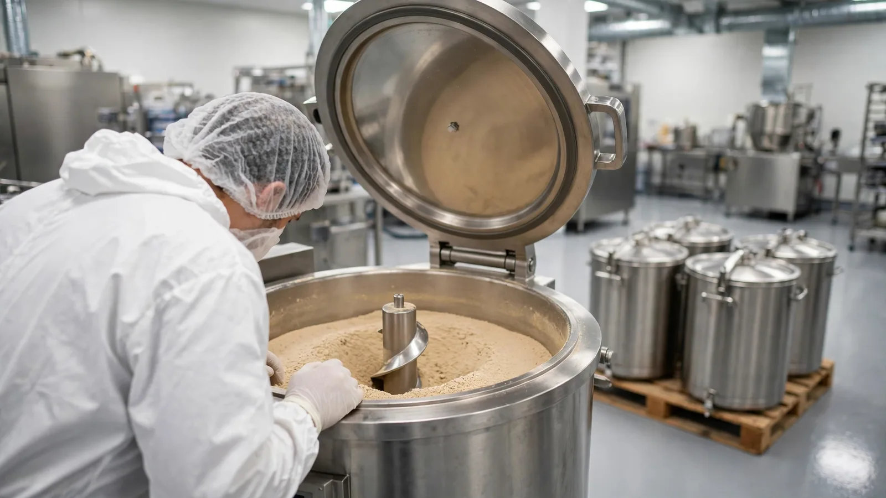
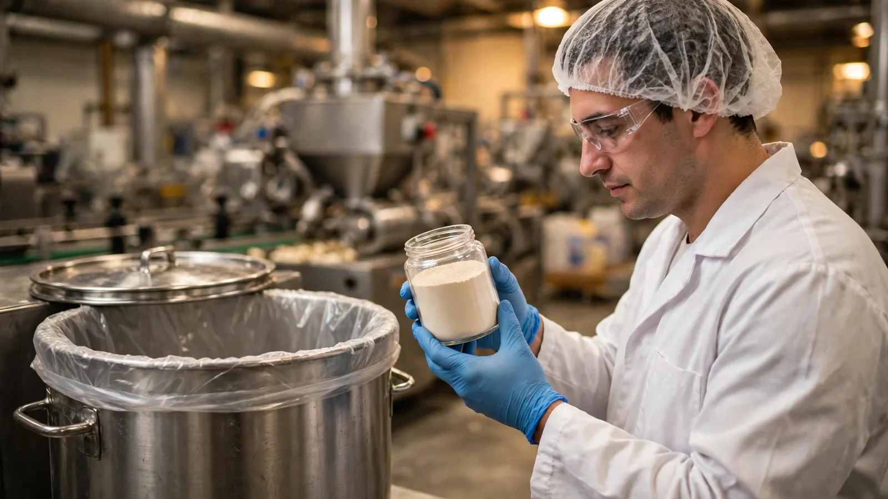

# Phosphatidylserine Premix and Blend Stability: Hold-Time and Oxidation Control for Contract Manufacturers (US & EU)

## Publishing Note

- Site: nutranexaps (Nutranexa — B2B phosphatidylserine ingredient supplier)
- Target audience: brand owners, procurement teams and formulation leads outsourcing phosphatidylserine blending, premixing and encapsulation to contract manufacturers in the US and EU
- Publish date: 2026-11-26
- Author: Nutranexa technical sourcing desk
- Internal assets referenced: two webp images (generated separately)

## Topic Planning Notes

- Rationale: the library already covers how to select a blending/premix partner and how to read an excipient compatibility data package, but no article addresses what happens on the production floor after blending ends — post-blend hold time, oxygen and moisture exposure during waiting periods, and the environmental controls a buyer should require in the contract manufacturing agreement. Premix hold-time control is a pure OEM production topic with clear buyer intent for CM-sourced programmes.
- Dedup check: grepped `premix`, `blend`, `hold time`, `stability` across D:\Projects\nutranexaps\content\resources\. Existing matches are supplier-selection (blending-premix-partner-selection), lab-side compatibility study design (excipient-compatibility-tableting), ingredient-level oxidative stability (peroxide/anisidine review) and finished-goods stability protocols (accelerated-stability-protocol, stability-shelf-life-review). None of these is dedicated to post-blend holding and premix stability controls at the CM. Slug `phosphatidylserine-premix-blend-stability-us-eu` has zero collision in repo and queue. Excluded angles (third-party lab testing, gummies/chewable formats, factory audit checklists, label claim accuracy) collide with existing articles and were rejected.
- Buyer intent: negotiating hold-time validation, environmental limits and handover controls into a contract manufacturing agreement for phosphatidylserine premixes, and reading the CM's answers critically before the first production batch.

## SEO Keywords

- phosphatidylserine premix stability contract manufacturer
- post-blend hold time supplement powder encapsulation
- phospholipid powder oxidation blend waiting time
- phosphatidylserine blend moisture migration caking premix
- hold time validation dietary supplement US EU
- phosphatidylserine OEM blending agreement quality controls

## SEO Metadata

- SEO Title: Phosphatidylserine Premix & Blend Stability: Hold-Time Control Guide (US & EU)
- Meta Description: A phosphatidylserine premix is most vulnerable after blending ends. Learn how to negotiate hold-time validation, oxidation and moisture controls into your US or EU contract manufacturing agreement.
- URL Slug: /resources/phosphatidylserine-premix-blend-stability-us-eu/
- H1: Phosphatidylserine Premix and Blend Stability: Hold-Time and Oxidation Control for Contract Manufacturers (US & EU)

## Outline

1. Why blend stability starts when mixing stops
2. The three degrading forces inside a PS blend: oxygen, moisture and unvalidated time
3. Validating a post-blend hold time at the contract manufacturer
4. Environmental and process controls to require in the blending agreement
5. Handover documents: what the PS supplier owes the contract manufacturer
6. FAQ, conclusion, sources

## Introduction

Most brand owners buying phosphatidylserine through a contract manufacturer assume that once the blend is made, the hard part is over. In practice, a PS premix is most vulnerable in the hours and days after blending ends — while it waits in totes, drums or hoppers for the encapsulation line, the sachet filler or the next production window. During that window the blend can oxidise at its exposed surfaces, pick up moisture from a humid room, or quietly lose the uniformity the blender was hired to deliver — a process parameter that separates a controlled OEM programme from a lottery. This article explains what degrades a phosphatidylserine blend after mixing, how a post-blend hold time should be validated, and which environmental and documentation controls belong in your contract manufacturing agreement. The oxidation side of this topic starts at the ingredient level — [see how Nutranexa verifies oxidative and identity controls for its PS grades](/quality-rd/) before any blend is built.

## Main Content

### Why Blend Stability Starts When Mixing Stops

Blend uniformity is achieved in minutes; it can be undone in days. A well-run blending step delivers a statistically uniform distribution of phosphatidylserine across the batch, but that uniformity is a transient condition, not a permanent property. Low-density, cohesive phospholipid powders and their typical blending partners — maltodextrins, cellulose derivatives, mineral premixes — differ in particle size, shape and density, so segregation pressure exists in every hopper transfer, every tote vibration and every pause on the mezzanine. The longer a blend waits, the more opportunities the material has to un-mix, cake or oxidise. For a buyer, the practical implication is that the quality of the finished capsule or sachet is decided as much by the schedule between blending and filling as by the blender itself. Yet when most OEM quotations are reviewed, blending is specified in detail — equipment, ribbon speed, mixing time — while the holding period that follows is described only as "as required by production planning." Closing that gap costs nothing except a clause in the agreement and a validation study the CM should be running anyway.

### The Three Degrading Forces Inside a PS Blend: Oxygen, Moisture and Unvalidated Time

Three forces act on a phosphatidylserine premix between the blender and the filling line. The first is oxygen. Phosphatidylserine is an unsaturated phospholipid; its fatty acid chains oxidise progressively at exposed surfaces, and a blend multiplies the exposed area by dispersing the lipid across a carrier. Every transfer that aerates the powder — a drop through a chute, a scooping operation, an open tote — refreshes the oxygen supply. The visible evidence eventually appears as a rising peroxide value, which is why the ingredient-level review of [peroxide and anisidine value on a PS certificate](/resources/phosphatidylserine-oxidative-stability-peroxide-value-us-eu/) matters again at the premix stage, not just at goods-in. The second force is moisture migration. PS powder itself is controlled for moisture and water activity, but blend partners differ wildly in hygroscopicity; a blend can move water from a wetter component to a drier one during holding, driving local caking and free-flow loss that shows up later as hopper bridging. The third force is time — specifically, unvalidated time. "Hold until the line frees up" is not a process parameter. Without a defined maximum hold period, none of the other controls has a limit to enforce, and the CM has no obligation to flag a blend that waited two days instead of two shifts.

<!-- Embedded CTA Box: Sample & Spec Match -->
<aside style="margin:36px 0;padding:24px 28px;background:#f5f8fc;border:1px solid #d7e0ec;border-left:4px solid #102a56;border-radius:3px;font-family:Arial,Helvetica,sans-serif;color:#1a2433;">

Factory Direct · Specification Review

<h3 style="font-family:Arial,Helvetica,sans-serif;font-size:22px;font-weight:700;margin:0 0 10px 0;color:#102a56;">Validating a Phosphatidylserine Grade Before Your First Order?</h3>

Send your current specification, target assay and application. We review grade, source (soy or sunflower), concentration and documentation against your programme, then ship samples with a lot-specific certificate of analysis for validation on your own line.

<a href="/contact/" style="display:inline-block;padding:11px 22px;background:#102a56;color:#fff;font-weight:700;font-size:14px;text-decoration:none;border-radius:2px;">Request Samples &amp; Spec Review →</a>
<a href="/products/phosphatidylserine/" style="display:inline-block;padding:11px 22px;background:#fff;color:#102a56;border:1px solid #102a56;font-weight:700;font-size:14px;text-decoration:none;border-radius:2px;">View Product Specifications</a>

</aside>

### Validating a Post-Blend Hold Time at the Contract Manufacturer

A hold time is validated the same way any process parameter is: define the worst realistic case, prove the product survives it, and write the limit into the batch record. The study design is straightforward. Take the actual PS blend — not a surrogate — hold it under the worst-case conditions the suite can produce, in the real containers and with the real interim storage, and sample at defined intervals. The endpoints should mirror what the blend must still deliver at filling: assay holds, peroxide value and anisidine value stay within limits, blend uniformity remains within acceptance criteria after the storage and transfers that occur during the hold, and the powder still flows through the hopper. The validated maximum hold time then becomes a number in the master batch record, and a batch that exceeds it is either retested, requalified or rejected — not quietly filled. When you tour a candidate CM or review their questionnaire, ask specifically which blends have validated hold times and whether phospholipid-containing premixes are among them. A vague answer is a finding. If the CM has never validated one, the study is a modest addition to the next engineering run — far cheaper than a released batch with a content-uniformity or oxidation complaint six months later.

### Environmental and Process Controls to Require in the Blending Agreement

Validation sets the limit; daily controls keep the blend inside it. The first control zone is the room itself: blending and interim holding areas for a phospholipid premix should carry defined temperature and humidity ranges, monitored and recorded rather than assumed. The second is oxygen exposure: closed totes or drums with minimal headspace, liners properly closed between transfers, and — where the CM supports it — nitrogen-flushed or inert-handled interim storage for lipid-sensitive blends, consistent with the nitrogen-handling practices many buyers already specify for bulk PS packaging. The third is handling discipline: no open scooping of the premix, minimal intermediate transfers, and scheduling that moves a blended batch to the filling line inside its validated window rather than parking it over a weekend. The fourth is segregation: PS premixes often share a suite with allergen-containing products, and the allergen segregation controls you already audit for blending apply equally to the holding area. Each of these belongs in the quality agreement or blending addendum as an explicit requirement with a verification method — a logged temperature, a closed-container standard, a scheduling rule — because a control that is not written down is a preference, not a commitment.

### Handover Documents: What the PS Supplier Owes the Contract Manufacturer

Hold-time control fails most often at the handover between ingredient supplier and contract manufacturer, so the document package should be built for it. The certificate of analysis must carry the oxidation-relevant rows — peroxide value, anisidine value where reported — plus moisture and water activity, so the CM's incoming testing checks the same numbers the blend study assumed. The safety data sheet should flag the lipid's oxidative sensitivity in plain language, because warehouse and blending staff take their cues from it. Beyond the standard pack, ask the supplier two questions that anticipate the premix stage: whether the grade's oxidative stability data supports a defined interim-holding assumption at ambient suite conditions, and whether the recommended storage conditions differ once the powder is dispersed in a carrier. The answers feed directly into the CM's validation design and the blend's acceptance limits. If the supplier and the CM are never introduced to each other's assumptions, the blend study gets designed around guesses. The supplier-selection side of this equation — what to demand from a blending partner before the first batch — is covered in [our blending and premix partner qualification guide](/resources/phosphatidylserine-blending-premix-supplier-selection-us-eu/), and the handover package described here completes the picture on the ingredient side.

<!-- Embedded CTA Box: Compliance & Documentation -->
<aside style="margin:36px 0;padding:26px 28px;background:#102a56;color:#eef2f8;border-radius:3px;font-family:Arial,Helvetica,sans-serif;">

Compliance &amp; Documentation

<h3 style="font-family:Arial,Helvetica,sans-serif;font-size:22px;font-weight:700;margin:0 0 10px 0;color:#fff;">Need COAs, SDS or Market-Specific Compliance Files?</h3>

Every shipment ships with a certificate of analysis and a safety data sheet, and market documentation is prepared per destination — US, EU and APAC programmes each carry their own declaration set. Ask for the document package behind any grade before committing volume.

<a href="/contact/" style="display:inline-block;padding:11px 22px;background:#c69a35;color:#102a56;font-weight:700;font-size:14px;text-decoration:none;border-radius:2px;">Request the Document Package →</a>
<a href="/resources/documents-for-ps-ingredients/" style="display:inline-block;padding:11px 22px;background:transparent;color:#fff;border:1px solid rgba(255,255,255,0.4);font-weight:700;font-size:14px;text-decoration:none;border-radius:2px;">See the Document Checklist</a>

</aside>

## FAQ

### Q: How long can a phosphatidylserine premix safely wait before encapsulation?

A: There is no universal number — the safe hold period depends on the blend composition, the suite's temperature and humidity, the interim containers and the handling steps in between. The correct answer is whatever the CM's validated hold-time study proves for your specific blend, written into the master batch record as a maximum with a retest rule for overruns.

### Q: Does nitrogen flushing matter at the premix stage, or only for bulk ingredient packaging?

A: It matters at both stages. Bulk PS packaging is typically nitrogen-handled because the lipid oxidises, and a blend multiplies the exposed surface area by dispersing that lipid across a carrier. Whether inert handling at the CM is practical depends on their equipment, but closed containers, minimal headspace and limited transfers are achievable on any line and should be required regardless.

### Q: Who owns hold-time validation — the brand or the contract manufacturer?

A: The contract manufacturer performs the study, because the hold time is their process parameter, but the brand owns the requirement. Specify in the quality agreement that a validated maximum hold time must exist for your blend, that the study uses the actual formulation, and that you receive the protocol and report as part of the batch documentation.

### Q: Which specification rows matter most for premix stability?

A: Peroxide value and anisidine value for oxidation, moisture and water activity for caking and moisture migration, and blend uniformity endpoints so the premix still meets content uniformity after holding. Comparing these rows at goods-in against the values assumed in the blend study is the simplest early-warning check a buyer can run.

## Conclusion

Premix stability is the quiet gap between two partners who each assume the other is watching the clock. The blend is uniform, the encapsulation line is qualified — and in between sits an unvalidated holding period where oxidation, moisture and segregation do their work. Closing the gap requires no new science: a validated hold time, written environmental limits, closed interim containers and a handover package that lets the supplier's data inform the CM's study. Build those clauses into the agreement before the first batch, and the question of how long a PS premix waited stops being a mystery. When you are ready to align your ingredient specification with your contract manufacturer's process, [contact the Nutranexa sourcing desk](/contact/) for grades, oxidative-stability data and the document package your blending programme needs.

## Sources

1. [FDA — Dietary Supplements: Current Good Manufacturing Practice (21 CFR Part 111, framework for production and process controls including holding requirements)](https://www.fda.gov/food/dietary-supplements)
2. [EUR-Lex — Regulation (EC) No 852/2004 on the hygiene of foodstuffs (general hygiene and holding requirements for EU production)](https://eur-lex.europa.eu/eli/reg/2004/852/oj)
3. [ICH — Quality Guidelines Q1A(R2): Stability Testing of New Drug Substances and Products (methodology reference for accelerated and real-time study design)](https://www.ich.org/page/quality-guidelines)
4. [AOCS — Official Methods for Lipid Oxidation Analysis (peroxide value and anisidine value methods)](https://www.aocs.org/attend/analytical-methods)
5. [PubMed — search: phosphatidylserine oxidative stability phospholipid powder](https://pubmed.ncbi.nlm.nih.gov/?term=phosphatidylserine+oxidative+stability)

## CTA

Nutranexa supplies soy-derived and sunflower-derived phosphatidylserine in 20, 50 and 70 percent grades, with lot-specific peroxide value, moisture and water activity data and the documentation your contract manufacturer needs for blend validation and hold-time studies. Contact us for samples, premix-ready specifications or the full document package for your next order.
